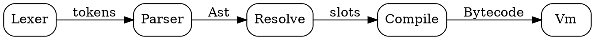
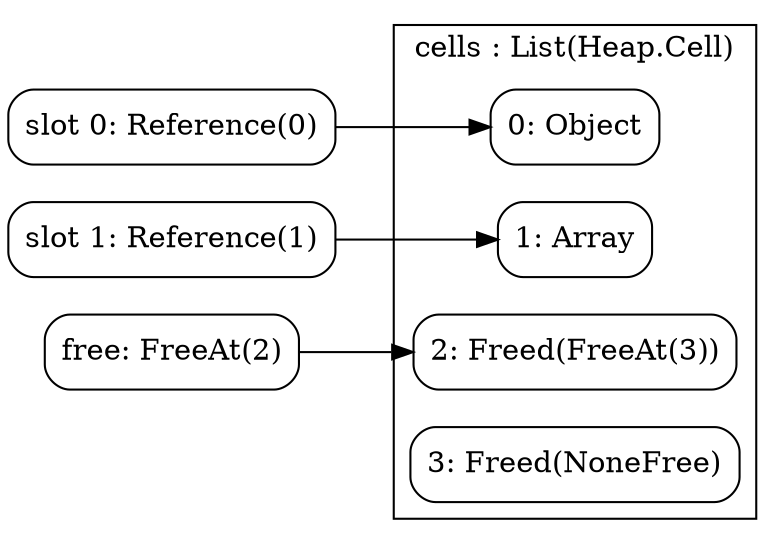
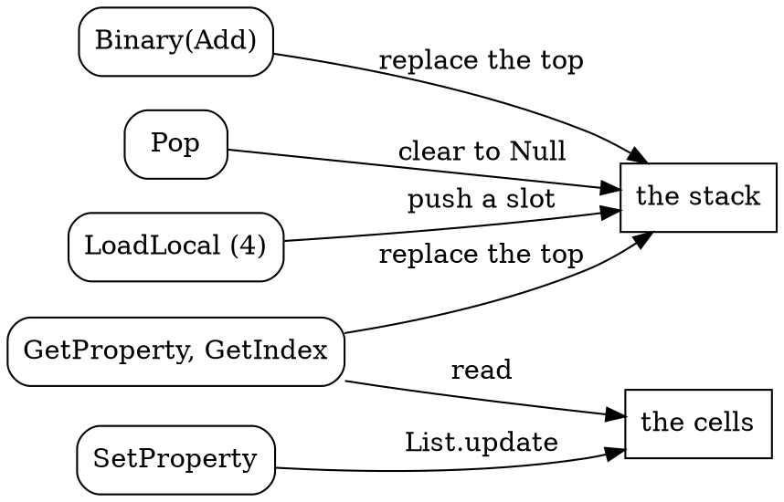
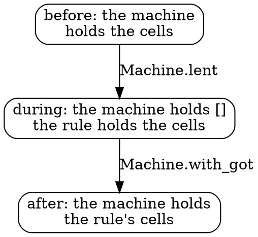
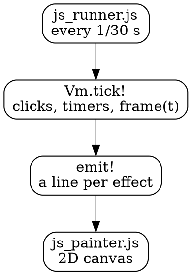
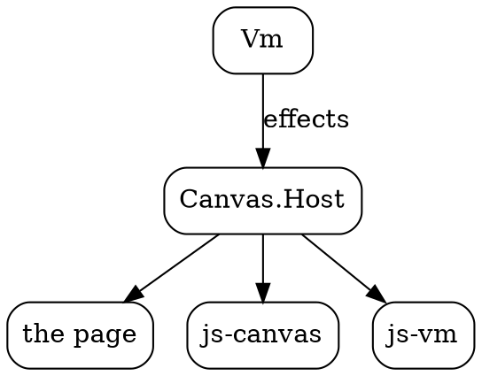
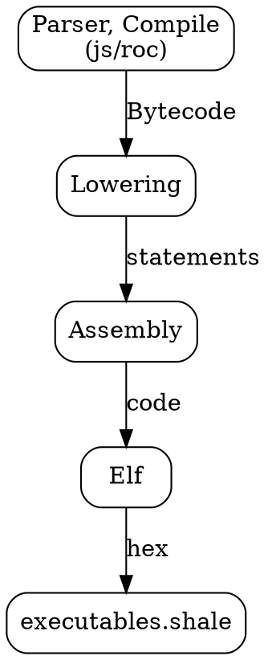
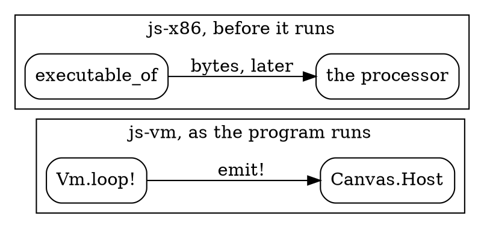

# A JavaScript Interpreter in Roc

A small book about [roc-js-interpreter](https://github.com/showell/roc-js-interpreter): a bytecode VM for a subset of JavaScript, written in Roc, a compiler of the same subset to x86-64, and what building it taught about Roc's values, its two backends and its build times.

## Introduction

The `js/` folder of roc-js-interpreter holds an interpreter for a subset of JavaScript, written in [Roc](https://www.roc-lang.org/). It runs as a command-line program, `js-vm`, and in a browser playground at [roc.lynrummy.com/js/](https://roc.lynrummy.com/js/), where a program draws on a canvas as it runs and a memory view shows its heap over time.

This book is for a reader who knows programming and is new to this codebase, and above all for one curious about writing a language's runtime in a language that has only values. AI coding agents (Claude) wrote the code, with human supervision, over three days, 2026-11-23 to 2026-11-25.

### What it runs

The subset is real JavaScript: numbers, strings, arrays, objects, closures, `let` and `const`, `try` and `finally`, `switch`, destructuring, optional chains, spread, Maps and Sets, and the timers. Classes run too, as syntax sugar the parser writes as plain functions (`0b6d8deb`). `this` outside a class's code, `new` on a program's own function and prototypes stay outside it, and `js/README.md` says why: each would make every call carry a receiver or every property read walk a prototype chain.

Here is one of the playground's samples, a turtle drawing a spiral:

{{file js/canvas/2-turtle-spiral.js}}

### Who judges it

Every program in the subset is real JavaScript, so node is a free oracle. `js/oracle.shale` runs each program in `js/tests/` through node 22 and through `js-vm`, and the two transcripts, exit codes included, must match byte for byte. A program outside the subset gets an error that names what it used: each program in `js/tests/refused/` names, on its first line, the message `js-vm` must end with. The corpus grew from 32 programs and 25 refusals on the first day (`278631d8`) to 61 and 76 (`js/README.md`, its status of 2026-11-24). Program 54, `54-big-daddy.js`, is a day in a small city that uses every feature of the subset, and it is also the playground's "all features" sample (`7d6a472f`, `cc904c2a`).

### Where the numbers come from

The project began as a folder of [roc-apps](https://github.com/showell/roc-apps) and moved to its own repository with its history on 2026-11-24, so a commit from before then may name a file that only roc-apps holds. Each number in this book comes from a commit message, cited by its short hash (a commit of roc-js-interpreter, or one of roc-apps' linked there), from `js/README.md`, or from another file of the repository, named where it is used. Code is quoted from the repository as it stands when the book is built.

{{chapter How it got here}} is the project's short history. The design starts at {{chapter The pipeline and the machine}}. The compiler to x86-64 has four chapters of its own, from {{chapter The compiler to x86-64}} to {{chapter What the compiler leaves to an optimizer}}.

## Motivation

The main reason is to push Roc on performance. An interpreter is a hard workload for a language of values: its heap must stay unique to be written in place, its machine record is handed on at every step, and it allocates all the time.

It stress-tests Roc's toolchain too. RC1's release builds are slow, the work turned up list-copy bugs that went upstream, and compile-time evaluation can run a program during `roc check`.

It teaches what copies. The three rules of {{chapter What copies}} are meant for any Roc user's code.

A pure functional language hosting a mutable, effectful one is a consequence of the project, not its goal. An underlying goal is to see how far AI coding agents, with human supervision, can take a Roc project. And it is fun to build things in Roc.

It is not a production JavaScript engine, and it is not for running untrusted code. It is not a race either: node is the oracle for correctness, not the yardstick for speed.

The book is written for the Roc community first.

## How it got here

This chapter is the history, kept brief. A reader who wants the design can skip ahead to {{chapter The pipeline and the machine}}.

### A tree-walker first

The first interpreter walked the tree (`30837f8e`). Its whole state was one value threaded through the walk: the heap, the scopes, the output and the step count. The same day it gained the node oracle, a wasm page with an editor and a Run button (`6a0ea512`), copy probes and exact allocation counts (`4dc98448`, `84263a4b`), variables resolved to slots before the run (`920cda0c`), a canvas library behind a host of effects (`65a8d71a`, `b8272c67`), and timers and clicks on one queue with a virtual clock (`941e9e67`). By the end of the day the walker passed 50 of 50 corpus programs and 44 of 44 refusals.

### The VM, in three rounds

The bytecode VM was built beside the walker in three rounds on 2026-11-24. The first round (`fe85d386`) brought the compiler and the stack machine, and refused what it had yet to cover as `js: unsupported (vm): ...`: 37 of 50 programs matched node, the VM refused the other 13, and every answer it gave was right. The second round (`60466bc7`, `b69660c4`) added exceptions, `switch`, labels, destructuring, optional chains, Maps and Sets, and the timers, and brought the VM to 50 of 50 and 44 of 44. The third round (`abb4fc0a`, `226eabfe`) added a mark-sweep collector. Before it, the programs in `js/heaps/` peaked at 164, 164, 40 and 64 MB; after it, each holds about 1,024 cells and peaks at 3.8 to 4.1 MB on the dev build (`62110109`).

### The page, and the walker's end

The playground moved onto the VM next: the canvas samples (`3d151f80`), then the page (`fd9fb4e4`). Then the walker was deleted (`aef0658b`): `Interp.roc`, `js-run` and `js-count` went, and the VM's expected-count files took the walker's names, so the check tier stayed the same.

The page gained a memory view (`668c52ca`, `c7a85d90`): a popup with the last run's heap over time. Then came a speed fix (`3aba5cf7`), the subject of {{chapter What copies}}. Two gaps closed next: calls nest 10,000 deep (`f4320451`), and a Map or a Set drops its deleted entries once they outnumber the rest (`865341ff`).

Classes came last, as syntax sugar (`0b6d8deb`, `be76fa0f`, `a2cd6994`). The parser writes each class as plain functions, one that sets the methods on an instance, one that runs the constructor's body and one that makes the instance and calls both, so `Resolve`, `Compile` and the VM see only functions.

### Garbage you can watch

Two samples followed for the memory view. `js/tests/55-garbage.js` makes 1,800 short-lived pieces, an object, an array and a closure each, in 12 rounds, so the memory view's sawtooth shows its teeth; node holds it like every corpus program, and the page lists it third (`a57db770`). `onCollect(fn)` is a playground extra, like `onClick` and outside JavaScript: its handler hears each collection after the sweep, as an event that runs between instructions, as a timer does. Node keeps its own collector hidden from a program, so the canvas log `9-garbage-heard` holds that sample, in `js-canvas` and on the page (`aa391df8`). The handler sits in the boxed event queue, so a program that ignores `onCollect` pays one match inside each collection and runs every instruction as before.

## The pipeline and the machine

A program's text becomes a run in five stages, each a module in `js/roc/`. This chapter follows a program through them, then looks at the one value the run works on: the machine.

### The pipeline

From the text to the run


- **`Lexer.roc`** makes tokens, each with its line and column.
- **`Parser.roc`** reads them into `Ast.roc`'s tree by recursive descent, and lays out each scope's names as it goes. It also writes each class as plain functions, so the stages after it see only functions.
- **`Resolve.roc`** places every name before the run: each read, write and declaration learns how many scopes out its variable lives and where it sits there. The interpreter then reads a variable by its place, and compares names only here.
- **`Compile.roc`** lays out each function's frame and makes each function, and the program itself, a flat list of `Bytecode.roc`'s instructions. Every jump is relative to the instruction after it, so a piece of compiled code means the same wherever it lands.
- **`Vm.roc`** runs them on a stack machine.

Beside them, `Inspect.roc` formats `console.log`'s output as node's `util.inspect` does, function for function, and `NumberText.roc` writes a number as `String(n)` does.

### The loop only dispatches

The VM's loop fetches the next instruction and hands the machine to `dispatch!`, whose match calls one top-level handler an arm. Each handler is a small function of its own, so the language grows by adding handlers and every function stays small. Here is the heart of the loop, a collection first when one is due:

{{lines js/roc/Vm.roc from "while Machine.is_running($machine)" to "$machine = dispatch!("}}

### The heap is one Roc value

JavaScript shares arrays, objects and closures by reference, and Roc has only values. So the interpreter keeps everything JavaScript shares in one list of cells, the heap, and a JavaScript reference is an index into it. {{chapter Memory strategy}} lays out the heap, the stack and what each operation costs.

### The machine

Everything a run holds is one record, `Vm.Machine`, handed to each instruction's handler and handed back:

{{lines js/roc/Machine.roc from "Machine : {" to "turtle : Box(Canvas.Turtle),"}}

The boxes in it are the subject of {{chapter What copies}}: each boxed part is one that most instructions leave alone.

## Memory strategy

Everything a JavaScript program shares lives in one Roc list, and every operation is shaped so that Roc writes that list in place. This chapter lays out the types, states what each operation costs and how that is checked, and follows one line of JavaScript through the machine.

### A reference is an index

A JavaScript value is one of these, and a `Reference` is the index of a cell in the machine's `cells : List(Heap.Cell)`:

{{lines js/roc/Heap.roc from "Value : [" to "Reference(U64),"}}

A cell is one of these:

{{lines js/roc/Heap.roc from "Cell : [" to "Freed(Heap.Free),"}}

An `Instance` is an object marked with the names of its class and of each class it extends, which `x instanceof C` reads. Two variables that hold one array hold one index, so each sees the other's writes.

### The free list

A freed cell stays in its place as `Freed(next)`, a link to the next free cell, and the machine's `free` names the first, `FreeAt(id)` or `NoneFree`. An allocation reads the link out of the first free cell and writes the new cell into its place with one `set`; only an empty free list appends:

{{lines js/roc/Heap.roc from "allocated : List(Heap.Cell), Heap.Free" to "{ cells: cells.set(id, cell)"}}

Garbage collection is what refills the free list; {{chapter The garbage collector}} says how.

Two references into the heap, and its free list


### Slots and boxes

A call's frame is a run of slots on the operand stack, from its base: its parameters, the variables its blocks declare, the hidden places of its `for ... of` loops, then the boxes it captures. An instruction names a slot by its place from the base, so a local is one index into the stack. The values being worked on sit above the slots, and the callers wait in `frames`. A push writes the place at `top`, and appends only past the stack's end:

{{function js/roc/Machine.roc pushed}}

A variable a closure may capture lives in a box, a `Variable` cell the frame and its closures share; the parser marks each scope that holds a function literal (`Ast.Capture`), and only those box their variables. A closure's `Fun` cell names an `Environment` cell, its code's number and the boxes it captures.

### What each operation costs

A control's count is what one more pass allocates, run at 1,000 and 10,000 passes ({{chapter Dev and release builds disagree}}). A write that copies its list allocates once a pass, so a flat count rules the copy out. A count is a count of allocations; the probes time a write at three sizes on the dev build (`js/README.md`, "What the probes say", 2026-11-24).

| operation | cost | how it is checked |
|---|---|---|
| allocate, a cell free | O(1), one `set` | 08-garbage-in-a-call: 1 a pass in release (the object's property list), its cells reused |
| allocate, the free list empty | amortized O(1), an append | unchecked: every control's heap stays one size |
| read a property | O(p) in the object's p properties | 08-garbage-in-a-call reads one a pass; O(p) unchecked (`find_first`) |
| write a property | O(p) | 04-property-write: 0 release, 1 dev; probe 14, 12, 12 µs beside 2,000 to 8,000 objects |
| read an item | O(1), a `get` | unchecked by a control |
| store an item | O(1) | 01-array-store: 0 release, 1 dev; probe flat to 8,000 items |
| push | amortized O(1) | 05-array-push: 1 release (the argument list); probe flat to 160,000 pushes |
| read or write a slot | O(1) | 00-loop: 0 in both builds |
| a boxed variable | O(1) | 02-closure-call's `++c`; probe flat beside 8,000 closures |
| call a closure | O(frame size) | 02-closure-call: 0 release, 1 dev |
| write a shared list | O(n), the list's length: the copy cliff | roc-apps' `get-after-set` copy shape: 1 whole-list allocation a write, every build |

`js/controls/expected-dev.txt` names the cause of each dev count, line by line.

### One line of JavaScript

The line `o.total = o.total + a[i];` runs in a loop whose frame holds `o` in slot 0, `a` in 1 and `i` in 2. These are the instructions `Compile.program` makes for it, printed for this chapter by a scratch program that runs `Parser.program_of` and `Compile.program` and writes each instruction with `Str.inspect`:

| instruction | the stack after | what it does |
|---|---|---|
| `LoadLocal(0)` | o | copies slot 0's reference to the top |
| `LoadLocal(0)` | o o | |
| `GetProperty("total")` | o t | reads cell 0's property in place of its reference |
| `LoadLocal(1)` | o t a | |
| `LoadLocal(2)` | o t a i | |
| `GetIndex` | o t x | reads cell 1's item |
| `Binary(Add)` | o s | two numbers: the VM's own fast path |
| `SetProperty("total")` | s | `Heap.with_property`, a `List.update` of cell 0 |
| `Pop` | | clears the place to `Null` |

What the line's instructions touch


Each instruction is O(1) but the two property lookups, O(p). The reads copy one `Value` onto the stack and leave the cells alone. The store hands `Heap.with_property` the list straight from the record it updates, `{ ..machine, cells: Heap.with_property(machine.cells, ...) }`, and `List.update` hands its function cell 0 as its sole owner, so the property is written in place. The stack is written in place too, by `set` at `top`.

That holds while the cells have one owner. `js/README.md`, "Why the heap is one value", lists the shapes that keep it so, each with a comment where it is used:

- a writer gets the list straight from the record it updates;
- a result is taken apart where it is answered, so its machine lives on alone;
- a writer asks what a cell is (`ValueRules.kind_of`), and leaves the cell in the heap;
- a stack place given up is cleared to `Null`;
- a loop over the machine is a `var $st` loop, so the machine stays out of every closure;
- the host travels as an argument of its own.

## The garbage collector

### What it does

`Collector.roc` is the VM's garbage collector, a precise mark and sweep. The VM names its roots, `marked` follows every reference from them through the cells, and `swept` turns each unmarked cell into a `Freed` cell on the free list. A live cell keeps its index, so every reference stays valid across a collection.

The sweep is where memory comes back:

{{lines js/roc/Collector.roc from "swept : " to "{ cells: $cells, free: $free, live: $live }"}}

Writing `Freed` over a garbage cell drops the cell that was there, and Roc's reference counting returns what it held (an object's properties, an array's items, a closure's boxes) to the allocator at that write. The heap's list keeps its length, and {{chapter Memory strategy}} shows an allocation taking a freed place. That is how the programs in `js/heaps/` went from peaks of 40 to 164 MB to about 4 MB each (`62110109`).

### Around the copy cliff

The collector is shaped around Roc's copy cliff, where a write to a list that something else still refers to copies the whole list first ("What copies" lists the shapes):

- **The marks are a list of their own.** `marked` reads the cells and writes only its marks and its stack of cells waiting to be visited, each in place, so every list it writes is its own. A mark bit inside each cell would make the first mark copy the heap.
- **The sweep owns the cells.** `collected` takes the cells out of the machine with `lent` before it calls `swept`, so each `set` in the sweep is the list's only reference and writes in place:

{{function js/roc/Machine.roc collected}}

- **The waiting stack reuses its places.** A visited cell's place is written over by the next one pushed, so the stack grows only to the mark's deepest point.

A count holds these three only loosely. On the dev build, 08-garbage-in-a-call's collections allocate 0.04 a pass, about one collection every thousand passes (`js/controls/expected-dev.txt`); one copy of the heap at each collection would add about a thousandth a pass, inside the ladder's tolerance of 0.05 a pass (`tools/alloc_ladder.shale`). So the guards are unchecked as copies; the heap programs' peaks of about 4 MB (`62110109`) are the nearest measure.

### Its roots, and when it runs

The roots are the machine's data:

{{function js/roc/Machine.roc roots}}

A collection is due when the free list is empty and the heap has reached its threshold. After each one, the threshold is twice what the collection kept, and at least 1,024 cells, so a collection's cost, O(heap), comes to amortized O(1) a cell allocated (unchecked by a timing):

{{function js/roc/Machine.roc is_collection_due}}

Between two instructions every value the program holds is in the machine. The one exception is a builtin that runs a callback, such as `filter` or `sort`: what it keeps across the callback waits on the stack, where the collections inside the callback see it. A live value that names a freed cell stops the run, since it means a root was missed.

## JavaScript's rules for values

This chapter is about the interpreter, the bytecode VM in `js/roc/`. The compiler to x86-64 in `x86/` gives values the same meanings in its runtime's machine code, as `x86/README.md` describes.

In JavaScript, one operator means different things for different values. `1 + 2` adds, and gives `3`. `"a" + 1` turns the number into text, and gives `"a1"`. `"5" * 2` asks for a string to become a number. A property read varies too: with `o` holding `{ x: 1 }`, `o.x` gives `1`, `o.y` gives `undefined`, and `[1, 2].length` reads a property every array has.

Here it is carried by plain Roc functions, one for each piece of meaning: what `+` makes of two values, what a property read gives, what a store does, and the words of each error. The project calls each of these functions a rule. A rule takes values and gives back a value, or stops the run with a message, or throws. The rules live in `ValueRules.roc` and four modules built on it, so each piece of meaning, and each message, has one home.

### The common cases, and the rest

Most operations in a running program are the common cases: two numbers added, an object's own property read, an array's item read. A call to a rule for each would cost more than the work. So each instruction's handler, in `Instructions.roc`, first checks for its common case and does it inline. Everything else goes to a rule.

| JavaScript | instruction | done by |
|---|---|---|
| `1 + 2` | `Binary(Add)` | inline, in `Instructions.binary` |
| `"a" + 1` | `Binary(Add)` | a rule, `ValueRules.add` |
| `o.x` | `GetProperty("x")` | inline, in `Instructions.property_read` |
| `o.y` | `GetProperty("y")` | a rule, `ValueRules.property` |
| `[1, 2].length` | `GetProperty("length")` | inline, in `Instructions.property_read` |

For `+` and the other operators, the check is one match on two numbers:

{{lines js/roc/Instructions.roc from "binary = |machine, operator, at| {" to "_ => Instructions.combined("}}

### `"a" + 1`

The left value is a `Text`, so the match falls through to `Instructions.combined`, which calls `ValueRules.binary`, whose `Add` arm calls `ValueRules.add`. There a string on either side makes both sides text. `ValueRules.text_of` writes the number 1 as `"1"`, as `String(1)` does, and the two join into `Text("a1")`. The VM puts that value in place of the two operands.

`true + 1` and `"5" * 2` reach the same rules, which mark the subset's edge: each stops the run with a message naming the coercion.

### A missing property

For `o.y`, `Instructions.property_read` looks through the object's own properties, finds `x` alone, and hands the read to `ValueRules.property`. For an object, that rule gives `Undefined` for a missing name, so `console.log(o.y)` prints `undefined`, as node does.

The eight names of `Object.prototype` in `ValueRules.is_prototype_name`, such as `toString`, stop the run with a message, since the subset leaves prototypes out.

### The cells are lent

In Roc, every value stays as it was made: `List.set(list, i, x)` returns a list with the new item, and any other holder of the old list keeps the old items. Roc keeps this fast: when the list has one holder, Roc writes into that list's own memory; when it has two, Roc first copies the whole list. That copy is the copy cliff of {{chapter What copies}}.

The heap is one list of cells, and the VM's machine record holds it ({{chapter Memory strategy}}). Some rules write it: `a.push(1)` reaches `ArrayRules.array_method`, which writes the array's cell, and a method that makes a new array allocates a cell.

If a rule received the cells while the machine still held them, two values would refer to the heap, and the rule's first write would copy all of it. Every `push` would cost the whole heap.

So the VM takes the cells out of its machine, which is left holding an empty list, and hands them to the rule as their one holder. The rule writes in place, and the VM puts back the cells the rule returns. That is all lending means: a hand-off of the only reference, for one call. `Machine.lent` takes the cells out:

{{function js/roc/Machine.roc lent}}

`Machine.shell` makes what the rule receives, a `ValueRules.Machine` of three fields: the cells, the free list, and the run's status, which the rule may set to a fault or a thrown value:

{{function js/roc/Machine.roc shell}}

The rule answers a `ValueRules.Got`, its value and that record after it. `Machine.with_got` puts the cells and the free list back, and the value on the stack, or takes on the fault or the throw.

Who holds the cells around a rule


The allocation controls check it ({{chapter Dev and release builds disagree}}). 05-array-push pushes through this path, and the release build is held to exactly one allocation a pass, its list of arguments (`js/controls/expected.txt`); a copy of the heap at each push would be a second.
### The four modules on it

`ValueRules` holds the operators, the property reads and writes, and the patterns. Four modules hold the rest, one kind of value each, and each takes the lent cells and answers a `Got`:

- **`StringRules`**: the methods of strings (`text_method`), those that count by position on ASCII text alone.
- **`ArrayRules`**: `push`, `pop`, `splice` and the other array methods that take only values. `map`, `filter`, `sort` and the others that call the program back run the VM's loop, so the VM runs them.
- **`CollectionRules`**: the walks that a spread, a pattern and `for ... of` make, and the methods of Maps and Sets.
- **`BuiltinRules`**: the starting globals, what `new` makes, and the builtins that give a value alone.

`console.log`, the canvas, the timers, the program's own functions and the host stay with the VM.

## A canvas in the browser

### What a program sees

In [the playground](https://roc.lynrummy.com/js/), a program is JavaScript from the subset plus a deliberately small API for one 400 by 400 canvas. It is a toy's API, sized for sketches, games of one screen and demonstrations:

- **Drawing:** `background`, `fill`, `stroke`, `line`, `rect`, `circle`, `ellipse`, `polygon` and `text`, named after p5.js's but a small set of their own, with colors as CSS strings.
- **A turtle:** `forward`, `back`, `turn`, `penUp`, `penDown` and `goto`.
- **Input:** `mouseX()`, `mouseY()` and `keyIsDown(key)`, read when called, and `onClick(handler)`.
- **Time:** `setTimeout`, `setInterval` and their clears, and a `function frame(t)`, which the page calls 30 times a second.
- **The memory view's hook:** `onCollect(handler)`, which hears each garbage collection.
- **`console.log`,** which writes under the canvas.

That is the whole of it: a program draws, listens and waits, and the page's DOM, the network and other files stay out of its reach. The playground's "click dots" sample uses most of it:

{{file js/canvas/7-click-dots.js}}

### The page

The page is `js/web/`. `js_page.js` makes everything the page shows, its styles included, so the HTML is only a door: an editor, the canvas and the console. `js_runner.js` loads `js.wasm`, the interpreter compiled from Roc, starts a program, then calls it a frame at a time, about 30 times a second. Each frame is a tick of the program's clock (`Vm.tick!`) that runs the clicks queued since the last tick, the timers due and `frame(t)`. `js_painter.js` paints each effect's line on a 2D canvas as it arrives, and the browser shows the canvas when the frame's call returns. The page's JavaScript only loads, ticks and paints; the program itself runs in the wasm.

One frame on the page


The memory view, `js_memory.js`, is a popup with two small charts of the last run. The top one is the heap's cells in use, which climb as the program allocates and drop at each collection, a sawtooth; the bottom one is the wasm memory's size.

`js/build.shale` names every file but `index.html` by its bytes, so a browser always loads the scripts that match its page, and it replaces the page only after `js/page_check.mjs` passes.

### How an effect travels

The interpreter reaches the world through a host, `Canvas.Host`, a record of four effectful functions:

{{lines js/roc/Canvas.roc from "Host : {" to "collected! : {"}}

An effect happens when the program calls for it: the VM hands each one to `emit!` in program order, `console.log` included, so a program that stops halfway has drawn what it drew before the stop. A read, `pointer!` or `key!`, is asked of the host when the program asks. `collected!` hears of each collection once it has swept. Every effect has one written form, `Canvas.line_of`, so a sample's golden log is the very text the page paints from.

Three hosts, one interpreter


- **The page's** host (`JsApp.roc`, on the platform in `js/wasm/`) calls into the page's JavaScript while the Roc call runs.
- **The recording host,** `js-canvas` (`JsCanvas.roc`), writes every effect and every read as a line, for the golden logs.
- **`js-vm`'s** host prints each log as it is made.

### The queue and its clock

`Events.roc` holds the one queue every callback goes through. A timer's callback, a click, the canvas's next `frame(t)` and a call of the `onCollect` handler after a collection are each an event, due at a time in milliseconds. The earliest runs first, and of two due at one time, the one queued first.

The clock is virtual. It reads 0 while the program's own code runs, and moves to each event's time as that event runs: on the page, a tick moves it on to the frame's time (`Vm.tick!`), and `js-vm` moves it from event to event until the queue is empty. So the order of the callbacks follows from the program alone, and a program prints the same on every run, and the same as node. Take this program:

```js
setTimeout(function f() { console.log("f"); }, 10);
setTimeout(function g() { console.log("g"); }, 0);
console.log("x");
```

| step | the clock | what runs | it prints |
|---|---|---|---|
| the program | 0 | queues `f` due at 10 and `g` due at 1, then logs | `x` |
| the first event | 1 | `g` | `g` |
| the second event | 10 | `f` | `f` |

`g` is due at 1: `Events.timer_requested` raises a delay below 1 ms to 1 ms, as node does. Node 22 and the dev build of `js-vm` each print `x`, `g`, `f` for it, run side by side for this chapter on 2026-11-25. The clock's column is read from `Events.roc`: an event is due at the clock plus its delay, and `with_event_taken` moves the clock to the due time of the event it takes.

## What copies

The project's performance work came down to Roc's copy rule and three habits that follow from it.

### Roc's copy rule

Roc writes a list in place only while the list has a single owner, and a copy is silent. On RC1 every copy is a use after a consume: a write (`List.set`, `append`, `Dict.insert`) takes the value, and something still reads the old one after it. The copy allocates the whole list again on every such write, so its cost grows with the list. roc-apps holds each shape below as a loop in its `tools/copy_shapes/`, checked in the release and dev builds.

Shapes that copy in every build:

1. The old list read after its write: `ys = xs.set(j, v) ?? xs`, then `xs.get(j)`. Reading first is free.
2. A closure over the list called after the write.
3. An inner list got, written and set back while the outer list still holds it. `List.update` hands the element over unshared and is free.
4. The old dict read after an insert, even its length.
5. A value got from a dict, written and inserted back while the dict still holds it.

Shapes that copy in the dev build only, where a helper stays a call that owns its arguments and the release build specializes it first:

6. A helper that reads its list after writing it.
7. A helper that reads the whole record inside the write of one of its fields.
8. `?? xs` on a list whose entries hold a reference count, such as a list of strings. `?? crash` is free.

A record update copies the record around the field it writes, inline sub-records included. A `Box` carried untouched is free, but every write re-boxes it, one allocation a write.

### A value is copied when it is handed on

Every VM instruction takes the machine and hands it back, and a handler copies the machine record on the way in, by the record rule above.

### Box what is rarely written

A part of the machine that most instructions leave alone costs a copy on every instruction if it sits inline. The event queue was the first example: only timers and clicks touch it, yet inline it made the release build's fib(22) take 123 ms; boxed, 82 ms (`15686d94`). Since every write re-boxes, a box suits a part that is rarely written after it is made.

### Stay under 256 bytes

LLVM copies a record of up to 256 bytes with eight vector moves, and calls `memcpy` for a bigger one. The collector's fields, the budget and the boxed turtle took the machine from 232 to 312 bytes, so every instruction paid a `memcpy` call. Boxing the collector's schedule alone left it at 288 bytes, still past the line, which is why that change left the times as they were. Boxing the builtins, the collector's schedule and count, and the step and effect budgets brought it to 248 bytes (`3aba5cf7`):

| release build, best of five, CPU | 312 bytes | 248 bytes |
|---|---|---|
| fib(22) | 110 ms | 99 ms |
| nested loops | 495 ms | 439 ms |
| `memcpy` in fib's profile | 16% | absent |

The lesson in `js/README.md` is that a field added inline counts against the 256, and boxing one part pays off only once the whole machine is back under the line. The line is a cliff: a machine past it pays the whole `memcpy`.

## Dev and release builds disagree

Roc has two backends. The dev backend (`--opt=dev`) compiles in about a second and emits code that is mostly stack moves. The release build (`--opt=speed`) goes through LLVM, runs fib(22) about nine times faster, and compiles slowly. The two builds disagree about allocations, about time and about copies, and this project met each disagreement.

### Allocation counts

`js/controls/` holds nine small programs, each a loop that does one kind of write. `js/controls.shale` runs each at 1,000 and 10,000 passes, counts `roc_alloc`'s calls exactly, and holds what one pass allocates to `expected.txt` (release) and `expected-dev.txt` (dev). A control left out of a file is held to 0.

| control | dev | release |
|---|---|---|
| 00-loop | 0 | 0 |
| 01-array-store | 1 | 0 |
| 02-closure-call | 1 | 0 |
| 03-string-building | 0 | 0 |
| 04-property-write | 1 | 0 |
| 05-array-push | 2 | 1 |
| 06-push-pop | 2 | 1 |
| 07-map-set | 4.08 | 2.08 |
| 08-garbage-in-a-call | 3.04 | 1 |

Most of the difference is one cause. The dev build lowers closures to boxes, so a `List.update` whose lambda captures a value that holds a reference count (a key, a value, a list) allocates once per write to box the capture. That allocation is a box and the list stays in place, and the release build makes it zero times (the files' own comments say so line by line). One dev allocation remains unexplained: 02-closure-call's 112-byte list per call, which roc-alloc-trace puts down to `Vm.pushed` and which three rewrites left in place (`js/README.md`).

This difference forced a decision. The walker's heap writers were first rewritten as `List.update` calls (`46c08a1d`); the release build held every control, and four dev controls rose by one. The change was reverted (`53f986a1`), then brought back (`22cd72db`) under the rule that Roc code should read well and play well with tooling, even at the cost of a little noise in dev builds. The dev expected file was rewritten, and every new line in it explains its allocation.

### Copies that happen only in dev

Some copies are made only by the dev build, at a helper's boundary: there a helper stays a call that owns its arguments, where the release build specializes it first. "Roc's copy rule" lists three such shapes. This project met two kinds:

- **A rule generic over the whole machine.** When `ValueRules` was split out, a version that took the engine's whole machine as an open record came first. The dev build copied the cells a rule wrote through it (a probe measured 3 allocations a write against 1), and the walker's dev controls went red, 05-array-push rising from 3 to 12.73 a pass (`d8d6b7fe`). The rules now take a small machine of the cells, which the VM lends and takes back.
- **A planted copy the release build optimized away.** Twice, a `List.drop_last` was planted back into the walker's scope handling. Each time the dev ladder went red on 02-closure-call alone (15 to 16 in `920cda0c`, 3 to 4 in `2233adc9`) and the release ladder stayed green, because the release build makes zero copies there.

The second case is why the dev ladder is useful: it sees copies the release build optimizes away, and those copies are often a sign of a shape that will copy in release once the code around it changes.

### Timings

Dev timings fail to predict release timings, even in direction.

| change | dev fib(22) | release fib(22) | source |
|---|---|---|---|
| walker: variables read by slot | 674 to 435 ms | 83 to 67 ms | `920cda0c` |
| walker: loops, same change | 4,387 to 2,105 ms | 486 to 475 ms | `920cda0c` |
| walker: the Map control's branch against master | 676 to 642 ms | 121 to 169 ms | `3b4f9bd1` |
| VM today | about 860 ms | 99 ms | `js/README.md` |

The first two rows show a change that halved the dev time of the loops while moving the release time by 11 ms. The third shows a branch that was faster than master on dev and 40% slower in release. Today the release build runs fib(22) about nine times faster than the dev build (860 against 99 ms).

### Step budgets

The page runs a program on the browser's main thread, so it holds the program to step budgets: 3,000,000 steps before the first frame and 300,000 a frame. The walker counted statements; the VM counts calls and loop passes, so the same budget covers about twice the work. On the dev backend the walker took 1.1 s of CPU to run out a frame's budget and 5.2 s for a program's; the VM takes 2.0 s and 8.8 s (`fd9fb4e4`, `js/README.md`, "Pitfalls").

### What each build is for

roc-apps' `CLAUDE.md` (section 9) and `js/README.md` give each build its job. Screen on the dev build: allocation counts are deterministic, so a change that moves one shows on the dev ladder in seconds, and most trials end there. Measure on the release build, once per round, from one shared build (`tools/roc_build.shale` keys each build by its inputs, so a ladder, a timing and a heap probe of the same tree share it). A dev-build timing says little about the program.

## Build times

RC1's release builds were the project's slowest loop, against under a second for a dev build of the same code (the message of roc-apps' tag `rc1-slow-release-build`). The walker's release build grew with the language:

| the walker's release build | time | source |
|---|---|---|
| when the controls first landed | 65 s | `84263a4b` |
| after the language gaps | 686 s | `f0837ff4` |
| `js-run`, about 10,000 lines of Roc | 1,052 s | roc-apps' tag `rc1-slow-release-build` |
| the JavaScript tier, most of it in RC1's SpecConstr pass | 11 to 17 min | roc-apps' [`762c7d3a`](https://github.com/showell/roc-apps/commit/762c7d3a) |

The VM's first round still imported the walker's module for the value rules. After the value rules moved into a module of their own and the VM dropped that import (`d8d6b7fe`), its build fell to an eighth, while `js-run` still took 481 s. The commits leave the cause of the drop unstated.

| the VM's release build | time | source |
|---|---|---|
| the first round, importing the walker | 670 s | `29cb46ec` |
| after the import was dropped | 84 s | `15686d94`, `d7ce2f2c` |
| after the collector | 110 s | `f9188b2f` |
| today | 91 s | `js/README.md`'s status line |

The interpreter works RC1's release pipeline harder than most Roc projects do. Jack Scully profiled the compiler on this code at roc-apps' [`762c7d3a`](https://github.com/showell/roc-apps/commit/762c7d3a) and opened three pull requests against RC1's SpecConstr pass. Each is measured alone, on his machine, against `js-run`'s 271 s release build before them (the pull requests' descriptions):

| pull request | what it changes | `js-run`'s release build |
|---|---|---|
| [#13408](https://github.com/roc-lang/roc/pull/13408) | puts cheap checks ahead of the pass's inlining queries | 166 s |
| [#13409](https://github.com/roc-lang/roc/pull/13409) | restructures the walk those queries run | 63 s |
| [#13410](https://github.com/roc-lang/roc/pull/13410) | stops a recursive function from unrolling into its own body; `fib.js` runs 12% faster and `loops.js` 14% | 83 s |

He put the three together at about 12 times faster for this repository's code specifically (Zulip, #off topic > LLVM). They are expected to merge after Roc 0.10, so every build time above is RC1's own.

## How it is tested

A check is trusted once it has been seen to fail. Each check below holds the code to a fixed answer, and each count is exact.

### The oracle against node

`js/oracle.shale`, a tier of the default `check.shale`, holds every corpus program's transcript and exit code to node's, 61 of them, and every refusal to its message. Every program runs, and the run fails if any one fails. It also runs with `collect=every`, which collects after every instruction that allocates, and programs 51 to 53 hold values through each kind of root while collections run.

### Controls held exactly

`check.shale js=1` runs the nine allocation controls of {{chapter Dev and release builds disagree}}, in both builds. A missing expected file fails the run (`80b5e681`).

### Golden logs for the canvas

`js/canvas.shale` holds each of the 9 canvas samples to its log of effects for scripted frames, keys and clicks, and a log moves only by an explicit freeze.

### page_check

`js/page_check.mjs` drives the page's own JavaScript under node. It holds the wasm to node on every corpus program and refusal, holds the samples to their golden logs, and checks the memory view. The page is replaced only after it passes.

### Planted faults

The record lists five plants, each reverted:

- a line width of 72 instead of 80 turned one program red (`278631d8`);
- the event queue left out of the roots turned 52 red, and `filter`'s item left off the stack turned 53 red (`b623437d`);
- a wrong expected count turned 00-loop red by name (`80b5e681`);
- a memory view with its collection marks taken out turned page_check red (`668c52ca`).

## Limitations

The subset covers a part of JavaScript on purpose, and it will never cover every corner of the language. A program that steps outside it is refused with a message naming what it used; it never gets a wrong answer.

The limits fall in three groups: the runtime is small on purpose, the language is fairly complete, and a few limits come from the tools.

### Runtime

- **In the browser, a program gets only the playground's small API:** one 400 by 400 canvas, the mouse and keys, the timers, `frame(t)`, `onCollect` and `console.log` ({{chapter A canvas in the browser}}). Every statement of the program runs in the Roc VM, compiled to wasm. The page's own JavaScript paints the lines the VM emits and passes clicks and keys in; the program's code runs only in the VM.
- **At the command line, `js-vm`'s runtime is as small:** `console.log`, the timers, and the builtins `js/README.md` lists under "The subset" (`Math`, the methods of strings, arrays, Maps and Sets, `Object.keys` and its kin). Files, processes, `require`, the network and node's other modules are out of reach. The compiler to x86-64 in `x86/` keeps the same small runtime.
- **Async is out:** promises, `async` and `await` are refused. Timers are the one way to wait, on a virtual clock that runs each callback after the program, in node's order.
- An interval never cleared stops after 100,000 callbacks with a message, where node runs it for good (`js/README.md`, "The subset").
- On the page, a program is held to step budgets, 3,000,000 before the first frame and 300,000 a frame ({{chapter Dev and release builds disagree}}).

### Language

The language itself is fairly complete: numbers, strings, arrays, objects, closures, `let` and `const`, `try` and `finally`, `switch`, destructuring, optional chains, spread, Maps, Sets and classes ({{chapter Introduction}}). These are its known differences from node:

- Each class instance holds its own method closures, so `a.m === b.m` is false where node's is true (`js/README.md`, "Classes are syntax sugar").
- A method read off an instance and called alone keeps its instance, where node loses `this` and throws (the same section).
- Printing or listing a class instance, or printing a class, is refused: node prints an instance by its class's name, and an instance here holds its methods beside its fields (the same section).
- An exhausted Map iterator still sees entries added after it finished, where node's stays done. No corpus program holds this yet.
- A builtin's callback (`map`, `sort`, a Map's `forEach`) throws a RangeError once 400 calls wait under it, where a plain call goes 10,000 deep, near node's own limit (`f4320451`).
- A string method that counts positions is refused on non-ASCII text: JavaScript counts UTF-16 units, and these strings are UTF-8 (`js/README.md`, "The subset").

The parser refuses these forms, each with a message that names it: getters and setters, `#private` names, class fields, static blocks, computed method names, class expressions, `this` outside a class's code or in a static method, `super` misused, a constructor that returns a value, `extends` of anything but a class declared above, a class's name declared again or assigned, `new` on a program's own function, `var`, `in`, `eval`, regular expressions, async and modules. A run refuses `==` and the other coercions, and the rest of `js/README.md`'s list, "The subset", where only the run can see them.

### Other

- `js-vm` takes the program as one command-line argument, limited to 128 KiB (`js/README.md`, "Pitfalls").
- `onCollect` and the other canvas builtins are this project's own, so logs of effects judge them in place of node.

## The compiler to x86-64

The `x86/` folder holds a second way to run the subset: `js-x86`, an ahead-of-time compiler that turns a program into a static Linux x86-64 executable. Roc writes every byte of that file. The instruction encoder (`X86.roc`), the assembler (`Assembly.roc`) and the ELF writer (`Elf.roc`) are Roc modules, and the executable talks to the kernel directly, by the `syscall` instruction. The product holds no assembler, linker, LLVM or libc, and the executable needs none of them to run (`x86/README.md`).

It began as a hello-world executable on 2026-11-24 (`c3ff721`), and 47 minutes later it compiled a recursive `fib` to node's answer (`0c5ea7e`). By 01:21 UTC on 2026-11-25 it ran 45 of the corpus's 61 programs exactly as node does (`451306b`).

### The pipeline

From the text to the executable


- **The front end is the interpreter's own.** `JsToX86.roc` imports `Parser` and `Compile` from `js/roc/` as a package, so the compiler starts from the same `Bytecode` the VM runs ({{chapter The pipeline and the machine}}).
- **`Lowering.roc`** turns each function's bytecode into `Assembly` statements, one instruction's machine code after another, and hands each family of instructions to a module of its own: `OperatorLowering`, `BuiltinLowering` and `CallLowering`.
- **`Assembly.roc`** lays the statements out as bytes. A jump or a call that names a label gets a placeholder, patched once every label's place is known.
- **`Elf.roc`** wraps the code as an executable: an ELF header, one program header and one segment, read and execute, mapped at 0x400000.
- **The last step only carries.** Roc's default platform writes text alone to stdout, so `js-x86` prints the executable as hex, and `x86/executables.shale` turns each pair of digits back into its byte.

### A value in 8 bytes

A slot of the frame has to hold any JavaScript value. The compiler fits every value into the 8 bytes of a double, a scheme called NaN-boxing. A double has about 2^53 bit patterns that all mean NaN, and x86-64's arithmetic makes only two of them. So a number is its own double, and every other value is one of the spare NaNs: its top 16 bits are a tag, and its low 48 bits are an address or a constant (`x86/roc/Boxing.roc`):

| top 16 bits | value | low 48 bits |
|---|---|---|
| below 0xFFF9 | a number | the double's own |
| 0xFFF9 | `undefined`, `null`, `false`, `true` | 0, 1, 2, 3 |
| 0xFFFA | a string | its address |
| 0xFFFB | an array | its address |
| 0xFFFC | a plain object | its address |
| 0xFFFD | a function | its closure record's address |
| 0xFFFE | a Map, a Set or an iterator | its record's address |

The two NaNs the processor makes lie below every tag, so a value is a number exactly when its bits are below the first tag shifted into place: one unsigned compare.

**A known kind stays untagged.** The lowering walks each function's instructions keeping the kind of each slot and each place on the bytecode's stack: a number, a boolean, a string, an array and so on, or `Value`, a value whose kind only the run decides. Where two known numbers meet `+`, the code is one `addsd`, and it tests zero tags. A `Value` goes through the runtime, which tests the tag (`runtime_add`, `runtime_compare` and their kin). Since a value's bits are the same whatever the compiler knows of it, a place that widens to `Value` where two ways meet costs zero instructions. A function's parameters and its result take their kinds from the whole program: the lowering runs pass after pass until every call's argument kinds and every return's kind settle (`Lowering.program_items`).

### The runtime

Every executable carries the runtime, about 15 KB of machine code (`x86/README.md`): the start, the allocator, buffered output, `console.log`'s writing of values as node writes them, the array methods, the Maps and Sets, and the timers. It is written in Roc too, as lists of `Assembly` statements, one instruction a line through the short builders of `Emit.roc`. Here is the whole allocator:

{{function x86/roc/Runtime.roc allocate_items}}

Four registers belong to the runtime for the whole run: `r12` the stack's limit, `r13` the runtime's state, `r14` the heap's end and `r15` its next free byte, in a heap of 1 GiB. The allocator only bumps, so every allocation lasts until the program exits, and a program that fills the heap stops with a message saying the collector is still to come.

The executable of fib(22) is 24,558 bytes, nearly all of it the runtime: milestone 2's, before the runtime, was 1,010 bytes (`x86/README.md`).

### What it compiles

`x86/programs.shale` compiles each of the interpreter's 61 corpus programs and holds those whose executables print exactly what node prints to `x86/corpus.txt`: 45 of 61 (`451306b`). It also holds the 21 programs of `x86/tests/` to node, and the 28 of `x86/tests/refused/` to their refusals. The 16 corpus programs left stop at these, by the first reason each meets (`x86/README.md`, "The corpus"):

| programs | the first reason |
|---|---|
| 4 | a class |
| 3 | an error the program leaves uncaught, where node exits 1 |
| 2 | a number `console.log` can write only once number printing is written: a fraction, and an integer past 2^53 |
| 7 | one each: `Math.sin`, the string methods `substring` and `repeat`, a string beyond ASCII, a call of a number, an array's `at`, and `o.k++` |

The compiler refuses what it has yet to compile by name, before it writes a byte. What only a value can decide stops the executable as it runs, with a line `x86: ... is not compiled yet` on stderr and exit 1.

## Why a compiler suits Roc

In one respect the compiler is the simpler of the two programs for Roc. An interpreter has to perform the program's effects while it runs. A compiler reads a text and gives back bytes, one transformation from start to end, and the effects wait for the executable.

### The interpreter has effects of its own

The VM runs the program inside the Roc call. When the program calls `console.log`, the VM hands the line to its host's `emit!` then and there; a timer waits on the event queue; a click arrives from the page ({{chapter A canvas in the browser}}). So the VM's loop is effectful, and Roc marks every function on that path with `!` and `=>`: 25 lines of `Vm.roc` declare such a function, and 38 lines across `js/roc/` (lines of the form `name! :`, counted for this chapter on 2026-11-25).

The run's whole state travels with those calls as one value, the machine, and most of the interpreter's performance work went into handing it on cheaply. The cells are lent to a rule and taken back, so a write to the heap stays in place ({{chapter JavaScript's rules for values}}). Every shape that would put a second owner on the heap is a copy cliff, and the machine record is held to 248 bytes so that handing it to each instruction costs vector moves in place of a `memcpy` ({{chapter What copies}}).

### The compiler is one function

The compiler's whole work is `executable_of`, from the program's text to the executable's bytes, or the reason it refuses:

{{function x86/roc/JsToX86.roc executable_of}}

Its type, `Str -> Try(List(U8), Str)`, has Roc's thin arrow: a pure function. Each stage it calls is pure too: `Parser.program_of`, `Compile.program`, `Lowering.program_items`, `Assembly.assemble` and `Elf.executable`. Across the 12,973 lines of `x86/roc/`, four definitions carry the `!` of an effect: `main!` and `write_program!` in each of the two drivers, `JsToX86.roc` and `Hello.roc`, which print the bytes (counted for this chapter on 2026-11-25).

Who does the program's effects


### The ultimate delegation

The program's effects still happen, later, and the processor does them. `console.log` ends in the runtime's `runtime_write`, which fills the output buffer, and the buffer goes out by a `syscall` instruction for `write`. The timers become `runtime_run_timers`, a loop in the executable over a virtual clock. The compiler writes each effect down as instructions, and the processor and the kernel perform them when the executable runs.

Many compilers hand their last step to a C compiler or to LLVM. This one hands it to the metal: the bytes Roc writes are the bytes the processor runs.

### What the copy rule still asks

With the effects gone, the machine record and its lending go too. The lowering's state is the kinds of one function's slots, made afresh for each function on each pass, and the passes are a plain loop over values that ends when the kinds settle. The one large value that grows is the code itself. `Assembly.roc` builds the bytes by appending to one list and patches the placeholders with `set` while that list has one owner, so both passes write it in place (the module's own comment; unchecked by an allocation count). The copy rule of {{chapter What copies}} still holds, and in the compiler it governs one list in one place.

A pure function is also plain to test. Each of the encoder's 98 `expect`s holds one instruction's bytes, `rsp` and `r12` as a base and the displacements at the edges of 8 and 32 bits among them, and each was read back through `objdump` during development (`x86/README.md`). An `expect` of a pure function needs a value in and a value out, and the host stays out of it.

The work moved, and some of it moved into the runtime. A routine that the interpreter writes as a Roc function, such as `console.log`'s layout of an array in columns, is in the compiler a list of x86-64 instructions, written one a line in Roc (`x86/roc/Inspect.roc`, 1,181 lines).

## The compiler against node

The executables beat `node file.js` on small programs, and most of that win is node's start-up. This chapter asks the harder question: once node's JIT has had time to warm up, how do the executables do? On the four programs timed, node wins at the large sizes, by 1.2 to 8 times.

### Where the numbers come from

Every number in this chapter is from `x86/BENCH.md` (`68f420b`), which `shale x86/bench.shale` measures; the one from `x86/README.md` says so. The timings stay outside `check.shale`, since the box is too noisy to gate on. They are one sample from one day, 2026-11-25, on the 2-core development box with node v22.23.2, and the book quotes them as recorded there.

Each program in `x86/bench/` defines `work(n)`:

- **fib**: a recursive `fib(n)`, so the cost is mostly calls.
- **loops**: nested loops over local variables and an array of 100 numbers, with a `%` in the inner body.
- **sieve**: the sieve of Eratosthenes over an array of `n + 1` flags built by `push`, mostly array reads and writes.
- **collatz**: the sum of the Collatz steps for every start from 1 to `n`, using `%`, `/` and `*` on doubles in a `while` loop.

The script checks that each executable prints exactly what node prints before it times anything, and each time is the median of 3 niced runs. **executable** is the compiled file's wall time, process start included. **node** is `node file.js`, start-up included. **warmed** runs `work(n)` in a loop inside one node process, throws away the first runs (200 at the small size, 3 at the large), and takes the median of the next 50 or 5; **first run** is that process's very first call. **vm** is the interpreter's release build, at the small sizes alone. The **ratio** is the executable's time over node warmed's, so above 1 means node is faster.

### The table

All times are in ms (`x86/BENCH.md`). A ratio in brackets is at a small size, where the executable's time is mostly its process start, rounded to a whole millisecond.

| program | executable | node | first run | warmed | ratio | vm |
|---|---|---|---|---|---|---|
| fib(22) | 1 | 48 | 2.0 | 0.3 | (3.2) | 112 |
| fib(35) | 222 | 213 | 212.1 | 190.1 | 1.17 | - |
| loops(2000) | 7 | 51 | 3.3 | 0.8 | (8.3) | 503 |
| loops(300000) | 831 | 172 | 142.6 | 132.9 | 6.25 | - |
| sieve(10000) | 2 | 68 | 2.7 | 0.1 | (11) | 82 |
| sieve(5000000) | 514 | 437 | 366.5 | 296.7 | 1.73 | - |
| collatz(10000) | 84 | 108 | 5.7 | 3.3 | (25) | 2,258 |
| collatz(300000) | 1,043 | 446 | 375.9 | 479.4 | 2.18 | - |

A second run a minute later had the same shape and a fair spread: loops(300000) took 1,261 ms in the executable against 155.6 warmed (8.10), fib(35) took 219 against 165.5 (1.32), and collatz(10000)'s executable took 27 ms where the first run had taken 84. Runs on this box differ by 30% or more. Every ratio at a large size stayed on the same side of 1.

### Small programs: the win is start-up

At the small sizes the executable takes 1 to 84 ms and `node file.js` 48 to 108. `node file.js` spends about 45 ms before it runs a line of the program, and the whole fib(22) executable runs in 1 ms. Inside a warm node process the same small workloads take 0.1 to 3.3 ms a run. So the executables' win over one-shot node on a small program measures start-up, and it is honest only as that.

The interpreter is the slower comparison: at the small sizes the VM's release build takes 82 to 2,258 ms, about 25 to 110 times the executable's time (`x86/BENCH.md`), and on fib(30), 1.6 million calls, about 220 times (`x86/README.md`).

### Large programs: warm node wins

Warmed, node is faster on all four:

- **fib**, by 1.2 to 1.3 times. All of fib's kinds are known, so the executable tests zero tags; what remains is its baseline code, which keeps every value in memory.
- **sieve**, by 1.7 times.
- **collatz**, by 2.2 times.
- **loops**, by 6 to 8 times, the widest gap.

One-shot node, start-up included, is faster at the large sizes too: in the table its time is below the executable's on all four, and fib's difference, 222 against 213 ms, is well inside the spread between runs.

**Most of V8's warm-up happens inside the first call.** At the large sizes the first run is already close to the steady time, because V8 optimizes a hot loop while it is still running (on-stack replacement). collatz's steady time came out slower than its first run in both runs, about 475 ms against about 370; `x86/BENCH.md` leaves the cause unexplored.

## What the compiler leaves to an optimizer

The compiler's code is plain, and {{chapter The compiler against node}} measures what that costs against V8. This chapter says what the compiler does to make code cheaper, what it leaves undone, and what comes next.

### Three ways, all from knowing

The compiler makes code cheaper in three ways, and all three come from knowing something before the run (`x86/roc/Lowering.roc`'s header, `x86/README.md`):

- a known kind skips the tag's test, so two known numbers add with one `addsd`;
- a function known by its code is called directly, and keeps the parameter kinds its calls give it;
- a function known before the program runs takes zero bytes in a slot, and becomes a closure record only where it is used as a value.

### The plain parts

Everything else is done the plainest way. Each function's frame is fixed: every slot, and every place on the bytecode's stack, has its own address below `rbp`, and an instruction loads its operands from there into `rax` or `xmm0`, works, and stores the result back. Each bytecode instruction becomes its own machine code, in order, and a call stays a call. A search of `x86/roc/` on 2026-11-25 finds zero mentions of inlining, constant folding, peephole passes or register allocation.

### Where an optimizer would pay

An optimizer would pay most on loops. The loops program has the widest gap, 6 to 8 times. A guess, unmeasured, as `x86/BENCH.md` gives it: a tight loop over a local array is where V8's registers and small integers help most, and where the executable's trips through memory cost most. A second guess, also unmeasured: loops and collatz both use `%`, which the executable lowers to `idiv`, one of the processor's slower instructions. The README's milestone 6, register allocation and type specialization for long numeric loops, is aimed at the first.

### What comes next

The compiler's own milestones say what follows (`x86/README.md`). Classes come first: four corpus programs stop at a class, and the parser already writes each class as plain functions, so the work is the `NewInstance` and `this` cells the VM's bytecode uses. Then milestone 4, the runtime in the subset: `console.log`'s formatting, Map and Set, and number printing, which three corpus programs wait on (02, 30 and 54), written in the JavaScript subset and compiled by this compiler. Then milestone 5, the collector, with the shadow stack as its roots, so a program can outgrow the 1 GiB heap and the whole corpus can be held to node. Then milestone 6, the register allocation and type specialization the loops above ask for.

## Appendix A: The playground's samples

Each of these runs in [the playground](https://roc.lynrummy.com/js/), where it can be changed and run again.

{{listing samples}}


## Appendix B: The tested programs

### The corpus

Each program prints what node prints, and `js/oracle.shale` holds the VM to it.

{{listing corpus}}

### The refused programs

The VM refuses each program with the message its first line gives.

{{listing refused}}
