# JavaScript in Roc: A Compiler and an Interpreter

A small book about [roc-js-interpreter](https://github.com/showell/roc-js-interpreter): a compiler of a subset of JavaScript to x86-64 and a bytecode VM for the same subset, both written in Roc, and what building them taught about Roc's values, its two backends and its build times.

## Introduction

roc-js-interpreter holds two programs that run one subset of JavaScript, and [Roc](https://www.roc-lang.org/) is the language of both. `js-x86`, in `x86/`, is an ahead-of-time compiler: it turns a program into a static Linux x86-64 executable. `js-vm`, in `js/`, is an interpreter: it turns the program into bytecode and runs that on a virtual machine. The two share a front end (the lexer, the parser, the resolver and the bytecode compiler), so they read a program's text the same way.

AI coding agents (Claude) wrote the code, with human supervision, starting on 2026-11-23 (`30837f8e`). This book is the record of that work and a reference for whoever guides it next. Every claim in it names the commit or file that backs it. Its central finding is about Roc itself: Roc writes a list in place only while one owner holds it, and a second owner turns each write into a copy of the whole list. Both programs were shaped around that rule, and a reader steering either one needs to know where it bites.

The book is written for a reader who knows programming and is new to this codebase, and above all for one curious about writing a language's tools in a language that has only values.

### What it runs

The subset is real JavaScript: numbers, strings, arrays, objects, closures, `let` and `const`, `try` and `finally`, `switch`, destructuring, optional chains, spread, Maps and Sets, and the timers. Classes run too, as syntax sugar the parser writes as plain functions (`0b6d8deb`). `this` outside a class's code, `new` on a program's own function and prototypes stay outside it, and `js/README.md` says why: each would make every call carry a receiver or every property read walk a prototype chain.

Where the two programs stood on 2026-11-27, on the 63 programs of the corpus in `js/tests/`:

| program | folder | corpus programs it runs as node does | held there by | source |
|---|---|---|---|---|
| `js-vm`, the interpreter | `js/` | 63 of 63 | `js/oracle.shale` | `js/README.md` |
| `js-x86`, the compiler | `x86/` | 51 of 63 | `x86/programs.shale` | `x86/README.md`, "The corpus" |

### Node as the oracle

Every program in the subset is real JavaScript, so node is a free oracle, and it judges both programs.

Node judges both programs
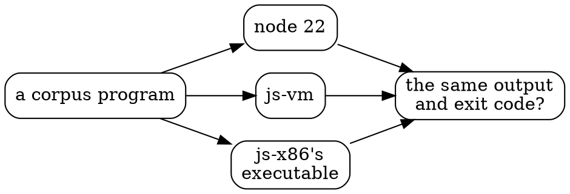

`js/oracle.shale` runs each program in `js/tests/` through node 22 and through `js-vm`, and the two transcripts, exit codes included, must match byte for byte. `x86/programs.shale` holds each executable's output and exit code to node's the same way. A program outside the subset gets an error that names what it used: each program in `js/tests/refused/` names, on its first line, the message `js-vm` must end with. The corpus grew over the five days:

| when | corpus programs | refused programs | source |
|---|---|---|---|
| the first day | 32 | 25 | `278631d8` |
| 2026-11-27 | 63 | 79 | `js/README.md`, its status line |

Program 54, `54-big-daddy.js`, is a day in a small city that uses every feature of the subset, and it is also the playground's "all features" sample (`7d6a472f`, `cc904c2a`).

### The playground

The interpreter also runs in a browser playground at [roc.lynrummy.com/js/](https://roc.lynrummy.com/js/), where a program draws on a canvas as it runs and a memory view shows its heap over time. Here is one of the playground's samples, a turtle drawing a spiral:

{{file js/canvas/2-turtle-spiral.js}}

```shot turtle-spiral
The turtle spiral on the playground's canvas, once it has drawn (js-book/canvas_shots.mjs, 2026-11-27).
```

### Where the numbers come from

The project began as a folder of [roc-apps](https://github.com/showell/roc-apps) and moved to its own repository with its history on 2026-11-24, so a commit from before then may name a file that only roc-apps holds. Each number in this book comes from a commit message, cited by its short hash (a commit of roc-js-interpreter, or one of roc-apps' linked there), from `js/README.md`, or from another file of the repository, named where it is used. Code is quoted from the repository as it stands when the book is built.

### The order of the book

{{chapter How it got here}} is the project's short history. Four parts follow it:

| part | starts at | what it covers |
|---|---|---|
| I: Shared machinery | {{chapter The front end}} | the front end, and {{chapter Roc's copy rule}}, which both programs lean on |
| II: The compiler | {{chapter The compiler to x86-64}} | one pure function from a program's text to an executable's bytes, the simpler program for Roc, so it comes first |
| III: The interpreter | {{chapter The interpreter}} | what the compiler hands to the processor: the program's effects, a heap, a collector and a page |
| IV: What Roc taught | {{chapter Why a compiler suits Roc}} | the lessons about Roc, its two builds and its build times |

A reader who came for the copy cliff can read four chapters in order: {{chapter Roc's copy rule}}, {{chapter Memory strategy}}, {{chapter The garbage collector}} and {{chapter Handing the machine on}}.

## Motivation

The main reason is to push Roc on performance. An interpreter is a hard workload for a language of values. Its heap must keep a single owner to be written in place ({{chapter Roc's copy rule}}), its machine record is handed on at every step, and it allocates all the time. The compiler pushes from the other side: Roc writes every byte of its executables, which race node and Roc's own LLVM build ({{chapter The fib race}}).

It stress-tests Roc's toolchain too. The project builds with RC1, a release candidate of Roc, whose release builds are slow. The work turned up list-copy bugs that went upstream, and compile-time evaluation can run a program during `roc check`.

It teaches what copies. {{chapter Roc's copy rule}} and the habits of {{chapter Handing the machine on}} apply to any Roc user's code.

A pure functional language hosting a mutable, effectful one is a consequence of the project, not its goal. An underlying goal is to see how far AI coding agents, with human supervision, can take a Roc project. And it is fun to build things in Roc.

It is not a production JavaScript engine, and it is not for running untrusted code. It is not a race either: node is the oracle for correctness, not the yardstick for speed. That is the interpreter's case; the compiler's chapters time the compiler against node.

The book is written for the Roc community first.

## How it got here

The whole project took five days, 2026-11-23 to 2026-11-27, and this chapter gives one section to each. The interpreter came first, and the compiler was built on its front end. Every step names its commit, so a reader can check out the code as it stood that day.

The five days
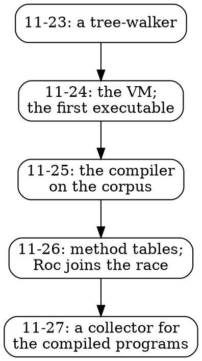

### 2026-11-23: a tree-walker

The first interpreter walked the tree (`30837f8e`). Its whole state was one value threaded through the walk: the heap, the scopes, the output and the step count. It grew fast that day:

| what the walker gained on its first day | commit |
|---|---|
| the node oracle, and a wasm page with an editor and a Run button | `6a0ea512` |
| exact allocation counts | `84263a4b` |
| variables resolved to slots before the run | `920cda0c` |
| a canvas behind a host of effects | `65a8d71a` |
| timers and clicks on one queue, with a virtual clock | `941e9e67` |

By the end of the day the walker passed 50 of 50 corpus programs and 44 of 44 refusals.

### 2026-11-24: the VM, and the compiler's first programs

The bytecode VM was built beside the walker in three rounds:

| round | commits | what it added | where it stood after |
|---|---|---|---|
| first | `fe85d386` | the VM itself | matched node on 37 of 50 programs, refused the other 13 |
| second | `60466bc7`, `b69660c4` | exceptions, `switch`, destructuring, Maps and Sets, the timers | 50 of 50 |
| third | `abb4fc0a` | a mark-sweep collector | the heap programs' peaks of 40 to 164 MB down to about 4 MB (`62110109`) |

The playground moved onto the VM (`fd9fb4e4`), and the walker was deleted (`aef0658b`). The page gained a memory view (`668c52ca`), a speed fix brought the VM's machine record under 256 bytes (`3aba5cf7`), and classes came as syntax sugar (`0b6d8deb`). The project moved from roc-apps to its own repository the same day.

At 20:39 UTC the compiler made its first executable, a hello world (`c3ff721`), and 47 minutes later it compiled a recursive `fib` to node's answer (`0c5ea7e`).

### 2026-11-25: the compiler on the corpus

By 01:21 UTC the compiler ran 45 of the 61 programs the corpus then held exactly as node does (`451306b`), and by 17:00, 47, with classes (`6ec8068`). The fib race began the same day, a long Fibonacci in limbs, compiled and timed against node (`b4eb82f`).

### 2026-11-26: method tables, and a third contestant

The methods moved off the instances (`e4834f9`): each class got one table of its methods, each method one function whose first parameter is the receiver, so that the compiler can call a method directly once it knows the receiver's class (`555b245`). Roc's own build of the fib race joined as a third contestant (`ee99278`), and the compiler came out even with it ({{chapter The fib race}}). The same day the compiler gained an integer kind for whole numbers proved in range (`81b5809`) and put small leaf functions in line at their calls inside loops (`7810da3`).

### 2026-11-27: a collector for the compiled programs

The compiled programs' heap gained a header on every block and pages of one block size each (`a328636`), then a mark and sweep from conservative roots, with a torture tier that collects at every allocation (`460b606`; {{chapter The garbage collector}}). Big daddy then ran at its full size, 10,000 rounds, with its heap at most 8.8 MB (`x86/COLLECTOR.md`).

## The front end

Both programs start from one front end: four stages, each a module in `js/roc/`, that turn a program's text into bytecode. A new piece of the language lands here first, and both programs see it at once. This chapter follows a program through the four stages, to the point where the two programs part.

### Four stages, two back ends

One front end, two back ends
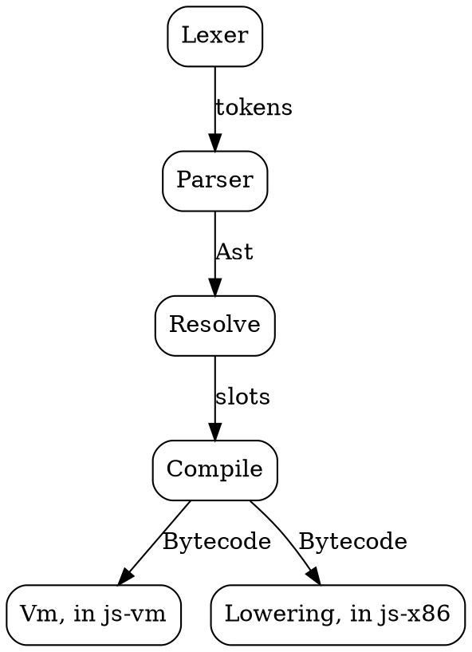

| stage | what it does |
|---|---|
| `Lexer.roc` | makes tokens, each with its line and column |
| `Parser.roc` | reads them into `Ast.roc`'s tree by recursive descent, and lays out each scope's names as it goes; it also writes each class as plain functions, through `ClassDesugaring.roc` |
| `Resolve.roc` | places every name before the run: each read, write and declaration learns how many scopes out its variable lives and where it sits there |
| `Compile.roc` | lays out each function's frame, and makes each function, and the program itself, a flat list of `Bytecode.roc`'s instructions |

Each technique is a standard one. Recursive descent is the classic hand-written parser. Resolving names to a scope depth and an index before the run is the lexical addressing of Scheme compilers (Abelson and Sussman, *Structure and Interpretation of Computer Programs*, second edition, 1996, section 5.5.6). After it, each back end reads a variable by its place, and only `Resolve` compares variables' names. Every jump in the bytecode is relative to the instruction after it, so a piece of compiled code means the same wherever it lands.

From there the bytecode goes one of two ways. In `js-vm`, `Vm.roc` runs it on a stack machine ({{chapter The interpreter}}). In `js-x86`, `x86/roc/Lowering.roc` turns it into machine code ({{chapter The compiler to x86-64}}).

### Classes are plain functions

The parser writes each class declaration as plain functions (`ClassDesugaring.roc`'s header). `class C extends P { ... }` becomes, in one declaration:

- C's table of methods, a plain object holding P's methods, then C's own, which replace P's of the same name;
- the constructor, a function of the instance and the constructor's parameters, whose `super(...)` calls P's;
- `C` itself, the function `new C(...)` calls: it makes the instance, marked with the names of C and of each class C extends and holding C's table, constructs it and answers it.

A method is one function for the whole class, made once, and its first parameter is the receiver. An instance holds only its fields; any other property is read from its class's table. So the stages after the parser see functions and objects, and two instructions, `NewInstance` and `InstanceOf`, which make a marked instance and test its mark.

### The frame

`Compile.roc` lays out each function's frame as a run of slots: its parameters, the variables its blocks declare, the hidden places of its `for ... of` loops, then the boxes it captures. An instruction names a slot by its place in the frame, and both back ends keep that layout. The VM's frame is a run of its operand stack ({{chapter Memory strategy}}, which also follows one line of JavaScript through its instructions); the compiler gives each slot an address of its own below `rbp` ({{chapter What the compiler leaves to an optimizer}}).

## Roc's copy rule

Roc has only values, yet it writes a list in place whenever it safely can. Both programs depend on that. The interpreter keeps a JavaScript program's heap in one Roc list, which many of its instructions write; the compiler builds an executable's bytes by appending to one list. Each is fast only while Roc writes its list in place. This chapter states when Roc does, and when it quietly copies the list first. Every later chapter that weighs a cost comes back to it, and {{chapter Handing the machine on}} gives the three habits the interpreter took from it.

### When a write copies

Roc writes a list in place only while the list has a single owner, and a copy is silent. On RC1 every copy is a use after a consume: a write (`List.set`, `append`, `Dict.insert`) takes the value, and something still reads the old one after it. The copy allocates the whole list again on every such write, so its cost grows with the list.

This book calls that drop the copy cliff. A loop that writes in place pays O(1) a write; the same loop with a second owner pays O(n) a write, and the code reads the same either way.

One write, two outcomes
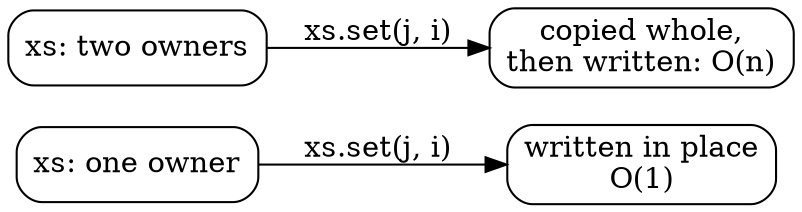

The technique behind the rule is reference counting with in-place update of a value held once, as in Lean 4 (Ullrich and de Moura, "Counting Immutable Beans", 2019) and Koka's Perceus (Reinking, Xie, de Moura and Leijen, 2021).

Each shape below is a loop in roc-apps' `tools/copy_shapes/CopyShapes.roc`, held to its count of allocations a write in the release and dev builds (`expected.txt` and `expected-dev.txt` beside it, measured on RC1). The listings are lines of those loops, each loop's call of itself written on one line; each copying shape sits beside its twin that writes in place. In brief:

| the shape that copies | it copies in | its twin, written in place |
|---|---|---|
| `get-after-set` | every build | `set-restored` |
| `closure-called-after` | every build | `closure-called-before` |
| `nested-get-then-set` | every build | `nested-update` |
| `dict-length-after-insert` | every build | - |
| `dict-get-then-insert` | every build | `dict-take-then-insert` |
| `helper-length-after-set` | the dev build | `helper-length-before-set` |
| `helper-reads-record` | the dev build | `index-bound-before` |
| `str-list-restored` | the dev build | `str-list-or-crash` |

### Shapes that copy in every build

**The old list read after its write.** The write takes the list only while it is the list's one reader:

```roc get-after-set: a copy a write
ys = xs.set(j, i) ?? xs
v = xs.get(j) ?? crash "get_after_set: in range"
```

Reading first is free:

```roc set-restored: in place
v = xs.get(j) ?? crash "set_restored: in range"
ys = xs.set(j, v + 1) ?? xs
```

**A closure over the list, called after the write.** The closure holds the old list:

```roc closure-called-after: a copy a write
at = |k| xs.get(k) ?? crash "closure_called_after: in range"
ys = xs.set(j, i) ?? xs
closure_called_after(i + 1, steps, size, ys, sum + at(j))
```

Called inside the write's own arguments, the same closure is free (`closure-called-before`): `ys = xs.set(j, at(j) + 1) ?? xs`.

**An inner list got, written and set back while the outer list still holds it:**

```roc nested-get-then-set: a copy a write
inner = rows.get(0) ?? crash "nested_get_then_set: outer in range"
written = rows.set(0, inner.set(j, i) ?? crash "nested_get_then_set: inner in range") ?? crash "nested_get_then_set: outer in range"
```

`List.update` hands the element over unshared, and is free:

```roc nested-update: in place
written = rows.update(0, |inner| inner.set(j, i) ?? crash "nested_update: inner in range") ?? crash "nested_update: outer in range"
```

**The old dict read after an insert, even its length:**

```roc dict-length-after-insert: a copy a write
d2 = d.insert(j, i)
dict_length_after_insert(i + 1, steps, size, d2, sum + d.len())
```

**A value got from a dict, written and inserted back while the dict still holds it:**

```roc dict-get-then-insert: a copy a write
l = d.get(0) ?? crash "dict_get_then_insert: key 0 is there"
dict_get_then_insert(i + 1, steps, size, d.insert(0, l.set(j, i) ?? l), sum + j)
```

Taking the value out of the dict first is free:

```roc dict-take-then-insert: in place
l = d.get(0) ?? crash "dict_take_then_insert: key 0 is there"
d0 = d.remove(0)
dict_take_then_insert(i + 1, steps, size, d0.insert(0, l.set(j, i) ?? l), sum + j)
```

### Shapes that copy in the dev build only

In the dev build a helper stays a call that owns its arguments. The release build specializes the helper first, and writes in place. These shapes still matter: a dev-only copy often becomes a release copy once the code around it changes ({{chapter Dev and release builds disagree}}).

**A helper that reads its list after writing it:**

```roc helper-length-after-set: a copy a write, dev only
bump_length_after = |xs, j, v| (xs.set(j, v) ?? xs, xs.len())
```

Reading the length first is free in both builds (`helper-length-before-set`):

```roc helper-length-before-set: in place
bump_length_first = |xs, j, v| {
	length = xs.len()
	(xs.set(j, v) ?? xs, length)
}
```

**A helper that reads the whole record inside the write of one of its fields:**

```roc helper-reads-record: a copy a write, dev only
kept = |d, a| (a + d.base) % d.cells.len()
helper_reads_record(i + 1, steps, size, { ..d, cells: d.cells.set(kept(d, j), i) ?? crash "helper_reads_record: in range" })
```

Bound on the line before, the same index is free (`index-bound-before`): `k = kept(d, j)`, then `d.cells.set(k, i)`.

**`?? xs` on a list whose entries hold a reference count,** such as a list of strings:

```roc str-list-restored: a copy a write, dev only
ys = xs.set(j, "x") ?? xs
```

`?? crash "..."` in its place is free in every build (`str-list-or-crash`).

### Records and boxes

A record update copies the record around the field it writes, inline sub-records included. A `Box` carried untouched is free, but every write re-boxes it, one allocation a write. {{chapter Handing the machine on}} shows both at work on the interpreter's machine record.

## The compiler to x86-64

`js-x86`, in `x86/`, turns a program into a static Linux x86-64 executable, and Roc writes every byte of that file. The instruction encoder (`X86.roc`), the assembler (`Assembly.roc`) and the ELF writer (`Elf.roc`) are Roc modules, and the executable talks to the kernel directly, by the `syscall` instruction. The product holds no assembler, linker, LLVM or libc, and the executable needs none of them to run (`x86/README.md`). So any byte the processor runs traces back to the Roc module that wrote it.

### The pipeline

From the text to the executable
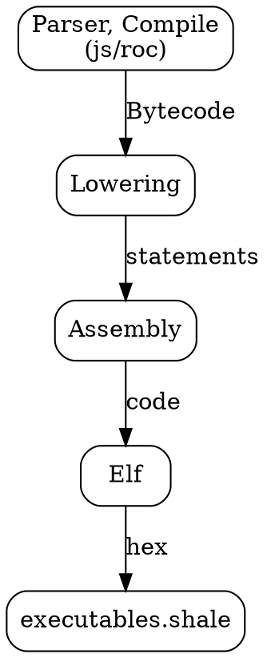

| stage | what it does |
|---|---|
| the front end, shared | `JsToX86.roc` imports `Parser` and `Compile` from `js/roc/` as a package, so the compiler starts from the same `Bytecode` the interpreter runs ({{chapter The front end}}) |
| `Lowering.roc` | turns each function's bytecode into `Assembly` statements, one instruction's machine code after another; `OperatorLowering`, `BuiltinLowering`, `CallLowering` and `IndexLowering` each take a family of instructions, and `Inlining` and four later passes are in {{chapter What the compiler leaves to an optimizer}} |
| `Assembly.roc` | lays the statements out as bytes; a jump or a call that names a label gets a placeholder, patched once every label's place is known: backpatching, as in a one-pass assembler |
| `Elf.roc` | wraps the code as an executable: an ELF header, one program header and one segment, read and execute, mapped at 0x400000 |
| `x86/executables.shale` | Roc's default platform writes text alone to stdout, so `js-x86` prints the executable as hex, and this script turns each pair of digits back into its byte |

### A value in 8 bytes

A slot of the frame that `Compile` lays out has to hold any JavaScript value. The compiler fits every value into the 8 bytes of a double by NaN-boxing, the representation LuaJIT and SpiderMonkey use. A double has about 2^53 bit patterns that all mean NaN, and x86-64's arithmetic makes only two of them. So a number is its own double, and every other value is one of the spare NaNs: its top 16 bits are a tag, and its low 48 bits are an address or a constant (`x86/roc/Boxing.roc`):

| top 16 bits | value | low 48 bits |
|---|---|---|
| below 0xFFF9 | a number | the double's own |
| 0xFFF9 | `undefined`, `null`, `false`, `true` | 0, 1, 2, 3 |
| 0xFFFA | a string | its address |
| 0xFFFB | an array | its address |
| 0xFFFC | a plain object | its address |
| 0xFFFD | a function | its closure record's address |
| 0xFFFE | a Map, a Set or an iterator | its record's address |

The two NaNs the processor makes lie below every tag, so a value is a number exactly when its bits are below the first tag shifted into place: one unsigned compare.

**A known kind stays untagged.** The lowering walks each function's instructions keeping the kind of each slot and each place on the bytecode's stack: a number, an `Integer`, a boolean, a string, an array and so on, or `Value`, a value whose kind only the run decides. Where two known numbers meet `+`, the code is one `addsd`. A `Value`'s tag is tested in line for `+` and the comparisons, and the runtime does the rest (`runtime_add`, `runtime_compare` and their kin). Since a value's bits are the same whatever the compiler knows of it, a place that widens to `Value` where two ways meet costs zero instructions. A function's parameters and its result take their kinds from the whole program: the lowering runs pass after pass until every call's argument kinds and every return's kind settle (`Lowering`'s `items_with_numbers`).

### The runtime

Every executable carries the runtime, about 24 KB of machine code: the start, the allocator, buffered output, `console.log`'s writing of values as node writes them, the array methods, the Maps and Sets, and the timers. It is written in Roc too, as lists of `Assembly` statements, one instruction a line through the short builders of `Emit.roc`. Here is the allocator, from `Heap.roc`:

{{function x86/roc/Heap.roc allocate_items}}

Four registers belong to the runtime for the whole run:

| register | holds |
|---|---|
| `r12` | the stack's limit |
| `r13` | the runtime's state |
| `r14` | the heap's end |
| `r15` | the heap's state |

They live in a mapping of 3 GiB: a heap of 2 GiB, then the collector's mark stack. The heap is 64 KiB pages of one block size each, every block behind a header word of its kind and size (`x86/COLLECTOR.md`). The allocator pops its size's free list or bumps through a page, and past a threshold it collects first ({{chapter The garbage collector}}).

The runtime dominates a small program's size:

| executable | size |
|---|---|
| `let x = 1;`, 2026-11-27 | 24,407 bytes (`x86/README.md`) |
| `x86/fib.js`, the same day | 24,837 bytes |
| fib(22) at milestone 2 of `x86/README.md`, before the runtime | 1,010 bytes (`0c5ea7e`) |

### What it compiles, as of 2026-11-27

`x86/programs.shale` compiles each of the 63 corpus programs in `js/tests/` and holds those whose executables print exactly what node prints to `x86/corpus.txt`: 51 of 63 (`x86/README.md`, "The corpus"). It also holds the 68 programs of `x86/tests/` to node and the 48 of `x86/tests/refused/` to their refusals. The 12 left stop at these, by the first reason each meets:

| programs | the first reason |
|---|---|
| 3 | an error the program leaves uncaught, where node exits 1 |
| 4 | a number `console.log` can write only once number printing is written: three fractions, and an integer past 2^53 |
| 5 | one each: `Math.sin`, an array of more than 100 items printed, a string beyond ASCII, a call of a number, and an array's `at` |

{{chapter Limitations}} says how the compiler refuses the rest.

## The compiler against node

The executables beat `node file.js` on small programs, and most of that win is node's start-up. This chapter asks the harder question: once node's JIT has had time to warm up, how do the executables do? On the four programs timed, node wins at the large sizes, by 1.2 to 8 times.

### Where the numbers come from

Every number in this chapter is from `x86/BENCH.md` (`68f420b`), which `shale x86/bench.shale` measures; the one from `x86/README.md` says so. The timings stay outside `check.shale`, since the box is too noisy to gate on. They are one sample from one day, 2026-11-25, on the 2-core development box with node v22.23.2.

That day came before the in-line paths of {{chapter What the compiler leaves to an optimizer}} (`17cb2b0`, `d6ecebd`), the integer kind and the register passes, and the four programs are unmeasured since. So the table speaks for that day's compiler alone, and a rerun on a quiet box will replace it.

Each program in `x86/bench/` defines `work(n)`:

| program | what `work(n)` does |
|---|---|
| fib | a recursive `fib(n)`, so the cost is mostly calls |
| loops | nested loops over local variables and an array of 100 numbers, with a `%` in the inner body |
| sieve | the sieve of Eratosthenes over an array of `n + 1` flags built by `push`, mostly array reads and writes |
| collatz | the sum of the Collatz steps for every start from 1 to `n`, using `%`, `/` and `*` on doubles in a `while` loop |

The script checks that each executable prints exactly what node prints before it times anything, and each time is the median of 3 niced runs. The table's columns:

| column | what it measures |
|---|---|
| executable | the compiled file's wall time, process start included |
| node | `node file.js`, start-up included |
| warmed | `work(n)` in a loop inside one node process: the first runs thrown away (200 at the small size, 3 at the large), then the median of the next 50 or 5 |
| first run | that process's very first call |
| vm | the interpreter's release build, at the small sizes alone |
| ratio | the executable's time over node warmed's, so above 1 means node is faster |

### The table, as of 2026-11-25

All times are in ms (`x86/BENCH.md`). A ratio in brackets is at a small size, where the executable's time is mostly its process start, rounded to a whole millisecond.

| program | executable | node | first run | warmed | ratio | vm |
|---|---|---|---|---|---|---|
| fib(22) | 1 | 48 | 2.0 | 0.3 | (3.2) | 112 |
| fib(35) | 222 | 213 | 212.1 | 190.1 | 1.17 | - |
| loops(2000) | 7 | 51 | 3.3 | 0.8 | (8.3) | 503 |
| loops(300000) | 831 | 172 | 142.6 | 132.9 | 6.25 | - |
| sieve(10000) | 2 | 68 | 2.7 | 0.1 | (11) | 82 |
| sieve(5000000) | 514 | 437 | 366.5 | 296.7 | 1.73 | - |
| collatz(10000) | 84 | 108 | 5.7 | 3.3 | (25) | 2,258 |
| collatz(300000) | 1,043 | 446 | 375.9 | 479.4 | 2.18 | - |

Runs on this box differ by 30% or more; in a second run, which `x86/BENCH.md` records, every ratio at a large size stayed on the same side of 1.

The vm column's 112 ms for fib(22) is a wall time, process start included, the median of three niced runs. {{chapter Handing the machine on}} quotes 99 ms for the same program from `js/README.md`: the best of five CPU times, on a quiet box. The two measure different things and agree in size.

### Small programs: the win is start-up

At the small sizes the executable takes 1 to 84 ms and `node file.js` 48 to 108. `node file.js` spends about 45 ms before it runs a line of the program, and the whole fib(22) executable runs in 1 ms. Inside a warm node process the same small workloads take 0.1 to 3.3 ms a run. So the executables' win over one-shot node on a small program measures start-up, and it is honest only as that.

The interpreter of Part III is the slower comparison: at the small sizes the VM's release build takes 82 to 2,258 ms, about 25 to 110 times the executable's time (`x86/BENCH.md`), and on fib(30), 1.6 million calls, about 220 times (`x86/README.md`).

### Large programs: warm node wins

Warmed, node is faster on all four (the two runs of `x86/BENCH.md`):

| program | warm node is faster by |
|---|---|
| fib | 1.2 to 1.3 times |
| sieve | 1.7 times |
| collatz | 2.2 times |
| loops | 6 to 8 times |

All of fib's kinds are known, so its executable tests zero tags; what remains is its baseline code, which keeps every value in memory.

One-shot node, start-up included, is faster at the large sizes too: in the table its time is below the executable's on all four, and fib's difference, 222 against 213 ms, is well inside the spread between runs.

**Most of V8's warm-up happens inside the first call.** At the large sizes the first run is already close to the steady time, because V8 optimizes a hot loop while it is still running (on-stack replacement). collatz's steady time came out slower than its first run in both runs, about 475 ms against about 370; `x86/BENCH.md` leaves the cause unexplored.

### The one tuned program

These four programs are measured as they came. One program was tuned for: the fib race, which {{chapter The fib race}} follows.

## The fib race

`x86/race/fib_race.js` computes F(740000) with the ordinary iterative algorithm. Its numbers are arrays of base-10^7 limbs, added one into the other in place. This race is where the compiler was tuned, so its record shows which changes paid and by how much. Three contestants run it, one after another, each timed from outside as its whole process (`shale x86/race.shale`):

| contestant | what runs |
|---|---|
| js-x86 | this repository's compiler, writing every byte of the executable from Roc |
| node | the same source |
| Roc | `x86/race/fibonacci_race.roc`, the same algorithm line for line, with `U64` limbs, built with `--opt=speed`, which hands the code to LLVM |

Each one's whole output, more than 150,000 digits, is held to a stored sha256 of the answer. The rules are fixed: the algorithm stays the ordinary one, node runs the same source, and any trick in the compiler has to be one that would help other programs too.

The ordinary algorithm is the slow one on purpose. Fast doubling, which takes F(2k) and F(2k + 1) from F(k) and F(k + 1), reaches F(740000) in about 20 steps of a few big multiplications each, where the race makes 740,000 big additions, and with a good multiplication it finishes in a fraction of a second. The race keeps the additions because its subject is the compiler: one hot loop of array reads, additions, a carry and array writes, the shape of code every program here leans on, run long enough to time well.

### Where it stood on 2026-11-26

One run each on 2026-11-26, at load 0.88 (`x86/race/README.md`, after `8989013`):

| contestant | time | |
|---|---|---|
| js-x86 | 55.75 s | 0.74 of node's time |
| Roc, LLVM | 56.42 s | js-x86 takes 0.99 of it |
| node | 75.80 s | |

Runs on this box move by about a tenth, so the honest reading is that js-x86 and LLVM's Roc are even, and both beat node by about a quarter. A day earlier, in the race's first form, node did seven times the compiled program's work.

### What the loop costs

The race lives in one loop, `addInto`'s, one limb a time round. Counted with `objdump` on 2026-11-26 (`x86/race/README.md`):

| one limb of `addInto`'s loop | instructions |
|---|---|
| Roc, LLVM | 46 to 51 |
| js-x86 at `c990f68` | 76 |
| js-x86 after the race's fixes 18 and 19 | 71 |
| js-x86 with the integer counter | 64 |

Of js-x86's 76, about 25 came from the numbers being JavaScript doubles: moves between the general and the floating-point registers, conversions to whole numbers for indexing, and unboxing an array's address. Roc pays for its own representation in turn: its `U64` arithmetic is checked, three overflow branches a limb, and each list write tests the list's reference count first.

What closed the gap were the fixes that `x86/race/README.md` numbers 1 to 19, every one a general rule with its own test. Among them: an array's length and items read in line, a comparison fused with its jump, a select of two numbers made with a conditional move, which ended the carry's mispredicted branch, and a loop's carried values kept in registers first.

### What remains

The largest lead the race's README ranked, an integer loop counter, is in: it is the 64 above. Its other leads, constants kept for the loop and an array's address reused, are open. The other races stood so against node, as of 2026-11-27:

| race | js-x86's time over node's | source |
|---|---|---|
| fib | 0.74 | above |
| bank ledger | 2.84 | `x86/bank/README.md`, "Against Roc" |
| fourteen | 2.60 | `x86/fourteen/README.md`, "Against Roc" |
| SAT, preliminary | 1.81 | `x86/satrace/README.md` |

The bank and fourteen races are object and call heavy, where node's hidden classes and inlining pay. The SAT race is rocsat's CDCL solver written in the subset, and its one run was on a busy box. A fifth race, big daddy, is a fork of the corpus's program 54 (`x86/bigdaddy/README.md`), which runs at its full size, 10,000 rounds, since the collector. Each race's README adds the runs made since.

## What the compiler leaves to an optimizer

The compiler's code is plain, and {{chapter The compiler against node}} measures what that costs against V8. This chapter is the map for anyone making the code faster: what the compiler already does to make code cheaper, what it leaves undone, and what comes next.

### What makes code cheaper

Each optimization the compiler makes is a standard technique (`x86/roc/Lowering.roc`'s header, `x86/README.md`):

| what the compiler does | where | the technique |
|---|---|---|
| a known kind skips the tag's test, so two known numbers add with one `addsd`; a whole number proved in range is an `Integer`, so a loop's counter steps with `add` and indexes an array as it is | `Lowering.roc`; `x86/README.md`, "An integer kind" | kinds found by iterating to a fixed point, as in dataflow analysis (Kildall, 1973) |
| a function known by its code is called directly, and keeps the parameter kinds its calls give it | `Lowering.roc` | a direct call of a known function |
| a function known before the program runs takes zero bytes in a slot, and becomes a closure record only where it is used as a value | `Lowering.roc` | a closure made only where it escapes |
| a class's field is read at the place its constructor gives it, and a method from its class's table, each tested in line | `FieldSlots.roc`, `MethodTables.roc` | Self's maps (Chambers, Ungar and Lee, 1989), which V8 calls hidden classes |
| for what is unknown, the commonest cases are tested in line, and the runtime's routine is called only when the test fails: `+` and the comparisons of two numbers, a number's tag test, and an array's `length`, item read and item write | `OperatorLowering.roc`, `IndexLowering.roc`; `17cb2b0`, `d6ecebd` | an inline cache (Deutsch and Schiffman, 1984, for Smalltalk-80) |
| a small leaf function called inside a loop is put in line in the bytecode, within a budget of instructions | `Inlining.roc` | inlining, a textbook optimization |
| after the lowering, a looping function's four busiest frame places live in registers | `Registers.roc` | register allocation by usage counts (Freiburghouse, 1974), the plainest kind, short of graph coloring (Chaitin, 1982) |
| three passes take out loads of what a register already holds, dead register moves, and jumps to jumps | `Forwarding.roc`, `Moves.roc`, `Jumps.roc` | peephole optimization (McKeeman, 1965) and jump threading |

### The plain parts

Everything else is done the plainest way. Each function's frame is fixed: every slot, and every place on the bytecode's stack, has its own address below `rbp`, and an instruction loads its operands from there into `rax` or `xmm0`, works, and stores the result back, or uses the register Registers gave the place. Each bytecode instruction becomes its own machine code, in order, and a call stays a call but for the inlined leaves. Registers renames at most four places a function, chosen by how often plain moves name them; a search of `x86/roc/` on 2026-11-27 finds zero mentions of constant folding.

### Where an optimizer would pay

An optimizer would pay most on loops. The loops program has the widest gap, 6 to 8 times. `x86/BENCH.md` offers an unmeasured guess: a tight loop over a local array is where V8's registers and small integers help most, and where the executable's trips through memory cost most. A second guess, also unmeasured, is that loops and collatz both use `%`, which the executable lowers to `idiv`, one of the processor's slower instructions. The README's milestone 6, type specialization for long numeric loops, is aimed at the first. In the fib race the cost was measured, by reading the machine code: eleven calls into the runtime for each limb, since an array's items are of unknown kind, which the in-line paths cut (`x86/race/README.md`).

### What comes next

The compiler's own milestones say what follows (`x86/README.md`):

| work | state |
|---|---|
| classes | compiled since `6ec8068`; the parser already writes each class as plain functions, so the work was the `NewInstance` and `InstanceOf` instructions of the bytecode |
| milestone 4, the runtime in the subset: `console.log`'s formatting, Map and Set, and number printing, written in the JavaScript subset and compiled by this compiler | next; four corpus programs wait on its number printing (02, 30, 58 and 54) |
| milestone 5, the collector of `x86/COLLECTOR.md` ({{chapter The garbage collector}}) | in (`a328636`, `460b606`) |
| milestone 6, the type specialization the loops above ask for | after milestone 4 |

Since 2026-11-26 an instance holds its class's table of methods, and a method takes its receiver as its first parameter, passed in `rdx` by every call through a value.

## The interpreter

The interpreter, js-vm, is the other way to run the subset, and the first one built ({{chapter How it got here}}). Where the compiler turns a program into an executable, the interpreter runs it directly: the front end's bytecode ({{chapter The front end}}) goes to `Vm.roc`, a stack machine written in Roc. It runs all 63 corpus programs as node does, so it is also the project's reference for what the subset means. It runs in two places:

| where | what runs | held by |
|---|---|---|
| the command line | `js/roc/JsVm.roc`, on a file | `js/oracle.shale`, which holds every corpus program's output to node's |
| the browser | the same VM compiled to wasm, the engine of [the playground](https://roc.lynrummy.com/js/), where a program draws on a canvas ({{chapter A canvas in the browser}}) | `js/page_check.mjs` ({{chapter How it is tested}}) |

The interpreter keeps a whole run in Roc values, so it needs its own memory, its own collector and its own care with copies, the subjects of {{chapter Memory strategy}}, {{chapter The garbage collector}} and {{chapter Handing the machine on}}. This chapter looks at the VM's loop, then at the one value the run works on: the machine.

Beside it, `Inspect.roc` formats `console.log`'s output as node's `util.inspect` does, function for function, and `NumberText.roc` writes a number as `String(n)` does.

### The loop only dispatches

The VM's loop fetches the next instruction and hands the machine to `dispatch!`, whose match calls one top-level handler an arm. Each handler is a small function of its own, so the language grows by adding handlers and every function stays small. Here is the heart of the loop, a collection first when one is due:

{{lines js/roc/Vm.roc from "while Machine.is_running($machine)" to "$machine = dispatch!("}}

### The heap is one Roc value

JavaScript shares arrays, objects and closures by reference, and Roc has only values. So the interpreter keeps everything JavaScript shares in one list of cells, the heap, and a JavaScript reference is an index into it. {{chapter Memory strategy}} lays out the heap, the stack and what each operation costs.

### The machine

Everything a run holds is one record, `Machine.Machine`, handed to each instruction's handler and handed back:

{{lines js/roc/Machine.roc from "Machine : {" to "turtle : Box(Canvas.Turtle),"}}

The boxes in it are the subject of {{chapter Handing the machine on}}: each boxed part is one that most instructions leave alone.

### Where its time goes

The interpreter has yet to be profiled instruction by instruction. What is known, as of 2026-11-27:

- Beside the compiler it is slow: at the small sizes of `x86/BENCH.md` the release VM takes 25 to 110 times the executable's time, and on fib(30), 1.6 million calls, about 220 times (`x86/README.md`).
- Each instruction is a fetch, a match in `dispatch!` and a handler's call, and the handler copies the 248-byte machine record on the way in, with eight vector moves ({{chapter Handing the machine on}}). The one profile taken, `perf record` of fib's release build on 2026-11-24, found `memcpy` at 16% of the time with the record at 312 bytes, and absent at 248 (`js/README.md`).
- Every instruction also passes the collector's check and the step count, and a property read or write searches the object's own properties, O(p) ({{chapter Memory strategy}}).

Measuring further is left for later. `perf` is closed to an unprivileged user on the development box (`perf_event_paranoid` is 4, `x86/buildrace/PROFILE.md`), and the samplers that profiled the compiler's code there, one by ptrace and one built into the executables (`x86/satrace/TRIAGE.md`), have only been pointed at the compiler so far.

## A canvas in the browser

The playground at [roc.lynrummy.com/js/](https://roc.lynrummy.com/js/) runs the interpreter in a browser, where a program draws as it runs. It is also the one place where the VM's effects reach a screen, so it shows most plainly how a pure Roc program hands effects to a host. This chapter covers what a program may call, how the page runs it, and how each effect travels.

### What a program sees

In the playground, a program is JavaScript from the subset plus a deliberately small API for one 400 by 400 canvas. It is a toy's API, sized for sketches, games of one screen and demonstrations:

| kind | the names |
|---|---|
| drawing | `background`, `fill`, `noFill`, `stroke`, `noStroke`, `line`, `rect`, `circle`, `ellipse`, `polygon` and `text`, named after p5.js's but a small set of their own, with colors as CSS strings |
| a turtle | `forward`, `back`, `turn`, `penUp`, `penDown` and `goto` |
| input | `mouseX()`, `mouseY()` and `keyIsDown(key)`, read when called, and `onClick(handler)` |
| time | `setTimeout`, `setInterval` and their clears, and a `function frame(t)`, which the page calls 30 times a second |
| the memory view's hook | `onCollect(handler)`, which hears each garbage collection |
| output | `console.log`, which writes under the canvas |

That is the whole of it: a program draws, listens and waits, and the page's DOM, the network and other files stay out of its reach. The playground's "click dots" sample uses most of it:

{{file js/canvas/7-click-dots.js}}

```shot click-dots
The click-dots sample after six clicks on its canvas (js-book/canvas_shots.mjs, 2026-11-27).
```

### The page

The page is `js/web/`. `js_page.js` makes everything the page shows, its styles included, so the HTML is only a door: an editor, the canvas and the console. `js_runner.js` loads `js.wasm`, the interpreter compiled from Roc, starts a program, then calls it a frame at a time, about 30 times a second. Each frame is a tick of the program's clock (`Vm.tick!`) that runs the clicks queued since the last tick, the timers due and `frame(t)`. `js_painter.js` paints each effect's line on a 2D canvas as it arrives, and the browser shows the canvas when the frame's call returns. The page's JavaScript only loads, ticks and paints; the program itself runs in the wasm. What reaches the canvas is the program's drawing alone, as here for the fractal tree sample:

```shot fractal-tree
The fractal tree sample's canvas, each branch two smaller ones (js-book/canvas_shots.mjs, 2026-11-27).
```

One frame on the page
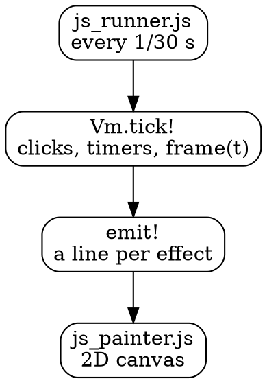

The memory view, `js_memory.js`, is a popup with two small charts of the last run. The top one is the heap's cells in use, which climb as the program allocates and drop at each collection, a sawtooth; the bottom one is the wasm memory's size.

The page runs a program on the browser's main thread, so it holds the program to step budgets: 3,000,000 steps before the first frame and 300,000 a frame, where the VM counts calls and loop passes (`js/README.md`, "Pitfalls").

`js/build.shale` names every file but `index.html` by its bytes, so a browser always loads the scripts that match its page, and it replaces the page only after `js/page_check.mjs` passes.

### How an effect travels

The interpreter reaches the world through a host, `Canvas.Host`, a record of four effectful functions:

{{lines js/roc/Canvas.roc from "Host : {" to "collected! : {"}}

An effect happens when the program calls for it: the VM hands each one to `emit!` in program order, `console.log` included, so a program that stops halfway has drawn what it drew before the stop. A read, `pointer!` or `key!`, is asked of the host when the program asks. `collected!` hears of each collection once it has swept. Every effect has one written form, `Canvas.line_of`, so a sample's golden log is the very text the page paints from.

Three hosts, one interpreter
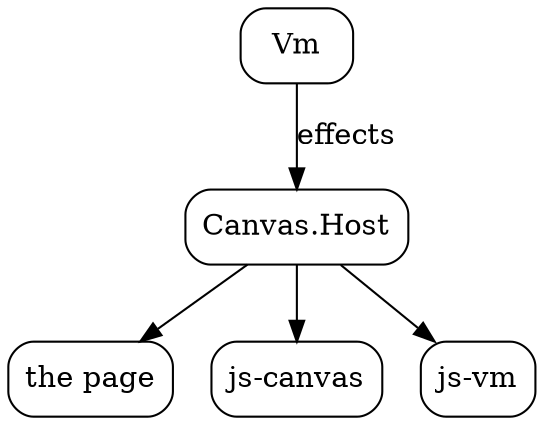

| host | module | what it does with an effect |
|---|---|---|
| the page's | `JsApp.roc`, on the platform in `js/wasm/` | calls into the page's JavaScript while the Roc call runs |
| the recording host, `js-canvas` | `JsCanvas.roc` | writes every effect and every read as a line, for the golden logs |
| `js-vm`'s | `JsVm.roc` | prints each log as it is made |

### The queue and its clock

`Events.roc` holds the one queue every callback goes through. A timer's callback, a click, the canvas's next `frame(t)` and a call of the `onCollect` handler after a collection are each an event, due at a time in milliseconds. The earliest runs first, and of two due at one time, the one queued first.

The clock is virtual. It reads 0 while the program's own code runs, and moves to each event's time as that event runs: on the page, a tick moves it on to the frame's time (`Vm.tick!`), and `js-vm` moves it from event to event until the queue is empty. So the order of the callbacks follows from the program alone, and a program prints the same on every run, and the same as node. Take this program:

```js
setTimeout(function f() { console.log("f"); }, 10);
setTimeout(function g() { console.log("g"); }, 0);
console.log("x");
```

| step | the clock | what runs | it prints |
|---|---|---|---|
| the program | 0 | queues `f` due at 10 and `g` due at 1, then logs | `x` |
| the first event | 1 | `g` | `g` |
| the second event | 10 | `f` | `f` |

`g` is due at 1: `Events.timer_requested` raises a delay below 1 ms to 1 ms, as node does. Node 22 and the dev build of `js-vm` each print `x`, `g`, `f` for it, run side by side for this chapter on 2026-11-25. The clock's column is read from `Events.roc`: an event is due at the clock plus its delay, and `with_event_taken` moves the clock to the due time of the event it takes.

## Memory strategy

Everything a JavaScript program shares lives in one Roc list, and every operation is shaped so that Roc writes that list in place. A change that gives the list a second owner turns each write into a copy of the heap. This chapter lays out the types, the cost of each operation and its check, and one line of JavaScript traced through the machine.

### A reference is an index

A JavaScript value is one of these, and a `Reference` is the index of a cell in the machine's `cells : List(Heap.Cell)`:

{{lines js/roc/Heap.roc from "Value : [" to "Reference(U64),"}}

A cell is one of these:

{{lines js/roc/Heap.roc from "Cell : [" to "Freed(Heap.Free),"}}

An `Instance` is an object marked with the names of its class and of each class it extends, which `x instanceof C` reads, and holding its class's table of methods, where a property outside the instance's own fields is read. Two variables that hold one array hold one index, so each sees the other's writes.

### The free list

A freed cell stays in its place as `Freed(next)`, a link to the next free cell, and the machine's `free` names the first, `FreeAt(id)` or `NoneFree`. An allocation reads the link out of the first free cell and writes the new cell into its place with one `set`; only an empty free list appends:

{{lines js/roc/Heap.roc from "allocated : List(Heap.Cell), Heap.Free" to "{ cells: cells.set(id, cell)"}}

Two references into the heap, and its free list
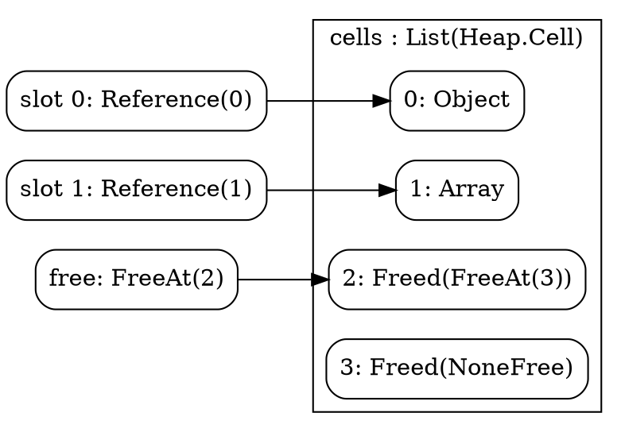

### Slots and boxes

In the VM, a call's frame ({{chapter The front end}}) is a run of slots on the operand stack, from its base, so a local is one index into the stack. The values being worked on sit above the slots, and the callers wait in `frames`. A push writes the place at `top`, and appends only past the stack's end:

{{function js/roc/Machine.roc pushed}}

A variable a closure may capture lives in a box, a `Variable` cell the frame and its closures share; the parser marks each scope that holds a function literal (`Ast.Capture`), and only those box their variables. A closure's `Fun` cell names an `Environment` cell, its code's number and the boxes it captures.

### What each operation costs

A control is a small program of `js/controls/`, a loop of one kind of write, and its count is what one more pass allocates, run at 1,000 and 10,000 passes ({{chapter Dev and release builds disagree}}). A write that copies its list allocates once a pass, so a flat count rules the copy out. A probe times a write at three sizes on the dev build (`js/README.md`, "What the probes say", 2026-11-24).

| operation | cost | how it is checked |
|---|---|---|
| allocate, a cell free | O(1), one `set` | 08-garbage-in-a-call: 1 a pass in release (the object's property list), its cells reused |
| allocate, the free list empty | amortized O(1), an append | unchecked: every control's heap stays one size |
| read a property | O(p) in the object's p properties | 08-garbage-in-a-call reads one a pass; O(p) unchecked (`find_first`) |
| write a property | O(p) | 04-property-write: 0 release, 1 dev; probe 14, 12, 12 µs beside 2,000 to 8,000 objects |
| read an item | O(1), a `get` | unchecked by a control |
| store an item | O(1) | 01-array-store: 0 release, 1 dev; probe flat to 8,000 items |
| push | amortized O(1) | 05-array-push: 1 release (the argument list); probe flat to 160,000 pushes |
| read or write a slot | O(1) | 00-loop: 0 in both builds |
| a boxed variable | O(1) | 02-closure-call's `++c`; probe flat beside 8,000 closures |
| call a closure | O(frame size) | 02-closure-call: 0 release, 1 dev |
| write a shared list | O(n), the list's length: the copy cliff | roc-apps' `get-after-set` copy shape: 1 whole-list allocation a write, every build |

`js/controls/expected-dev.txt` names the cause of each dev count, line by line.

### One line of JavaScript

The line `o.total = o.total + a[i];` runs in a loop whose frame holds `o` in slot 0, `a` in 1 and `i` in 2. These are the instructions `Compile.program` makes for it, printed for this chapter by a scratch program (`Parser.program_of`, `Compile.program`, then `Str.inspect` of each):

| instruction | the stack after | what it does |
|---|---|---|
| `LoadLocal(0)` | o | copies slot 0's reference to the top |
| `LoadLocal(0)` | o o | |
| `GetProperty("total")` | o t | reads cell 0's property in place of its reference |
| `LoadLocal(1)` | o t a | |
| `LoadLocal(2)` | o t a i | |
| `GetIndex` | o t x | reads cell 1's item |
| `Binary(Add)` | o s | two numbers: the VM's own fast path |
| `SetProperty("total")` | s | `Heap.with_property`, a `List.update` of cell 0 |
| `Pop` | | clears the place to `Null` |

What the line's instructions touch
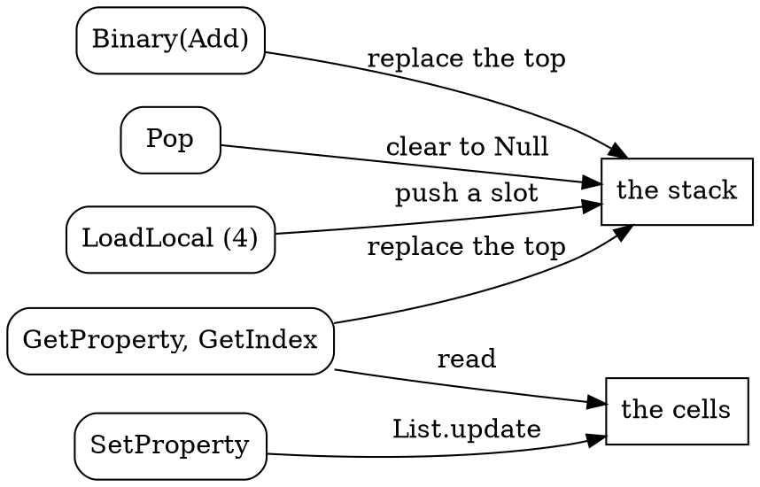

Each instruction is O(1) but the two property lookups, O(p). The reads copy one `Value` onto the stack and leave the cells alone. The store hands `Heap.with_property` the list straight from the record it updates, `{ ..machine, cells: Heap.with_property(machine.cells, ...) }`, and `List.update` hands its function cell 0 as its sole owner, so the property is written in place. The stack is written in place too, by `set` at `top`.

That holds while the cells have one owner. `js/README.md`, "Why the heap is one value", lists the shapes that keep it so, each with a comment where it is used:

- a writer gets the list straight from the record it updates;
- a result is taken apart where it is answered, so its machine lives on alone;
- a writer asks what a cell is (`ValueRules.kind_of`), and leaves the cell in the heap;
- a stack place given up is cleared to `Null`;
- a loop over the machine is a `var $st` loop, so the machine stays out of every closure;
- the host travels as an argument of its own.

## The garbage collector

The interpreter's collector visits every cell of the heap in one pass, so it is where a second owner of the cells would cost the most, and its design follows from that.

### What it does

`Collector.roc` is the VM's garbage collector, a precise mark and sweep, the technique of McCarthy's Lisp (1960). The VM names its roots, `marked` follows every reference from them through the cells, and `swept` turns each unmarked cell into a `Freed` cell on the free list. A live cell keeps its index, so every reference stays valid across a collection.

One collection
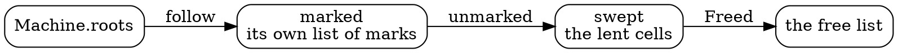

The sweep is where memory comes back:

{{lines js/roc/Collector.roc from "swept : " to "{ cells: $cells, free: $free, live: $live }"}}

Writing `Freed` over a garbage cell drops the cell that was there, and Roc's reference counting returns what it held (an object's properties, an array's items, a closure's boxes) to the allocator at that write. The heap's list keeps its length, and {{chapter Memory strategy}} shows an allocation taking a freed place. That is how the programs in `js/heaps/` went from peaks of 40 to 164 MB to about 4 MB each (`62110109`).

### Shaped around the copy cliff

The collector is shaped around Roc's copy cliff, where a write to a list that something else still refers to copies the whole list first ({{chapter Roc's copy rule}} lists the shapes):

- **The marks are a list of their own.** `marked` reads the cells and writes only its marks and its stack of cells waiting to be visited, each in place, so every list it writes is its own. A mark bit inside each cell would make the first mark copy the heap.
- **The sweep owns the cells.** `collected` takes the cells out of the machine with `lent` before it calls `swept`, so each `set` in the sweep is the list's only reference and writes in place:

{{function js/roc/Machine.roc collected}}

- **The waiting stack reuses its places.** A visited cell's place is written over by the next one pushed, so the stack grows only to the mark's deepest point.

A count holds these three only loosely. On the dev build, 08-garbage-in-a-call's collections allocate 0.04 a pass, about one collection every thousand passes (`js/controls/expected-dev.txt`); one copy of the heap at each collection would add about a thousandth a pass, inside the ladder's tolerance of 0.05 a pass (`tools/alloc_ladder.shale`). So the guards are unchecked as copies; the heap programs' peaks of about 4 MB (`62110109`) are the nearest measure.

### Its roots, and when it runs

The roots are the machine's data:

{{function js/roc/Machine.roc roots}}

A collection is due when the free list is empty and the heap has reached its threshold. After each one, the threshold is twice what the collection kept, and at least 1,024 cells, so a collection's cost, O(heap), comes to amortized O(1) a cell allocated (unchecked by a timing):

{{function js/roc/Machine.roc is_collection_due}}

Between two instructions every value the program holds is in the machine. The one exception is a builtin that runs a callback, such as `filter` or `sort`: what it keeps across the callback waits on the stack, where the collections inside the callback see it. A live value that names a freed cell stops the run, since it means a root was missed.

### The collector on the page

Two samples show the collector at work. `js/tests/55-garbage.js` makes 1,800 short-lived pieces, an object, an array and a closure each, in 12 rounds, so the memory view's sawtooth shows its teeth; node holds it like every corpus program, and the page lists it third (`a57db770`). Here is the memory view's top chart after one run on the page: the cells in use climb as the program allocates and drop at each collection, a dashed line, and the dots are what each collection kept.

```shot garbage-memory
The memory view's chart of the cells in use over one run of the garbage sample (js-book/canvas_shots.mjs, 2026-11-27).
```

`onCollect(fn)` is a playground extra, like `onClick` and outside JavaScript: its handler hears each collection after the sweep, as an event that runs between instructions, as a timer does. Node keeps its own collector hidden from a program, so the canvas log `9-garbage-heard` holds that sample, in `js-canvas` and on the page (`aa391df8`). The handler sits in the boxed event queue, so a program that ignores `onCollect` pays one match inside each collection and runs every instruction as before.

### The compiled programs' collector

The compiled programs have a separate collector of their own, designed in `x86/COLLECTOR.md`:

| | `Collector.roc`, in the VM | the compiled programs' |
|---|---|---|
| kind | a precise mark and sweep | a non-moving mark and sweep |
| works on | a Roc list of cells | raw memory: each heap block carries a header word of its kind and size, and blocks sit in pages of one size class |
| a reference | an index | an address |
| its roots | named exactly by the VM | found conservatively, in every word of the machine stack and the registers that looks like a heap address, as Boehm and Weiser's collector for C finds them (1988) |
| when it collects | once the free list is empty and the heap reaches twice what the last collection kept, at least 1,024 cells | at twice the last live size, and at least every 8 MiB |

The headers and pages came first (`a328636`), then the mark, the sweep and a torture tier that collects at every allocation (`460b606`). A floor of 8 MiB held big daddy at 8.8 MB, about a twelfth of node's peak on the same run; floors from 2 to 64 MiB kept its CPU time within 8% (`x86/COLLECTOR.md`, "Lane 3").

## JavaScript's rules for values

The compiler's runtime gives values their JavaScript meanings in machine code (`runtime_add` and its kin, {{chapter The compiler to x86-64}}). The interpreter gives them the same meanings in Roc, and this chapter shows how, with the hand-off of the heap that keeps those rules off the copy cliff.

In JavaScript, one operator means different things for different values. `1 + 2` adds, and gives `3`. `"a" + 1` turns the number into text, and gives `"a1"`. `"5" * 2` asks for a string to become a number. A property read varies too: with `o` holding `{ x: 1 }`, `o.x` gives `1`, `o.y` gives `undefined`, and `[1, 2].length` reads a property every array has.

Here it is carried by plain Roc functions, one for each piece of meaning: what `+` makes of two values, what a property read gives, what a store does, and the words of each error. The project calls each of these functions a rule. A rule takes values and gives back a value, or stops the run with a message, or throws. The rules live in `ValueRules.roc` and four modules built on it, so each piece of meaning, and each message, has one home.

### The common cases, and the rest

Most operations in a running program are the common cases: two numbers added, an object's own property read, an array's item read. A call to a rule for each would cost more than the work. So each instruction's handler, in `Instructions.roc`, first checks for its common case and does it inline. Everything else goes to a rule.

| JavaScript | instruction | done by |
|---|---|---|
| `1 + 2` | `Binary(Add)` | inline, in `Instructions.binary` |
| `"a" + 1` | `Binary(Add)` | a rule, `ValueRules.add` |
| `o.x` | `GetProperty("x")` | inline, in `Instructions.property_read` |
| `o.y` | `GetProperty("y")` | a rule, `ValueRules.property` |
| `[1, 2].length` | `GetProperty("length")` | inline, in `Instructions.property_read` |

For `+` and the other operators, the check is one match on two numbers:

{{lines js/roc/Instructions.roc from "binary = |machine, operator, at| {" to "_ => Instructions.combined("}}

### `"a" + 1`

The left value is a `Text`, so the match falls through to `Instructions.combined`, which calls `ValueRules.binary`, whose `Add` arm calls `ValueRules.add`. There a string on either side makes both sides text. `ValueRules.text_of` writes the number 1 as `"1"`, as `String(1)` does, and the two join into `Text("a1")`. The VM puts that value in place of the two operands.

`true + 1` and `"5" * 2` reach the same rules, which mark the subset's edge: each stops the run with a message naming the coercion.

### A missing property

For `o.y`, `Instructions.property_read` looks through the object's own properties, finds `x` alone, and hands the read to `ValueRules.property`. For an object, that rule gives `Undefined` for a missing name, so `console.log(o.y)` prints `undefined`, as node does.

The eight names of `Object.prototype` in `ValueRules.is_prototype_name`, such as `toString`, stop the run with a message, since the subset leaves prototypes out.

### The cells are lent

`List.set(list, i, x)` writes the list's own memory while the list has one holder; with two, Roc first copies the whole list, the copy cliff of {{chapter Roc's copy rule}}.

The heap is one list of cells, and the VM's machine record holds it ({{chapter Memory strategy}}). Some rules write it: `a.push(1)` reaches `ArrayRules.array_method`, which writes the array's cell, and a method that makes a new array allocates a cell.

If a rule received the cells while the machine still held them, two values would refer to the heap, and the rule's first write would copy all of it. Every `push` would cost the whole heap.

So the VM takes the cells out of its machine, which is left holding an empty list, and hands them to the rule as their one holder. The rule writes in place, and the VM puts back the cells the rule returns. That is all lending means: a hand-off of the only reference, for one call. `Machine.lent` takes the cells out:

{{function js/roc/Machine.roc lent}}

`Machine.shell` makes what the rule receives, a `ValueRules.Machine` of three fields: the cells, the free list, and the run's status, which the rule may set to a fault or a thrown value:

{{function js/roc/Machine.roc shell}}

The rule answers a `ValueRules.Got`, its value and that record after it. `Machine.with_got` puts the cells and the free list back, and the value on the stack, or takes on the fault or the throw.

Who holds the cells around a rule
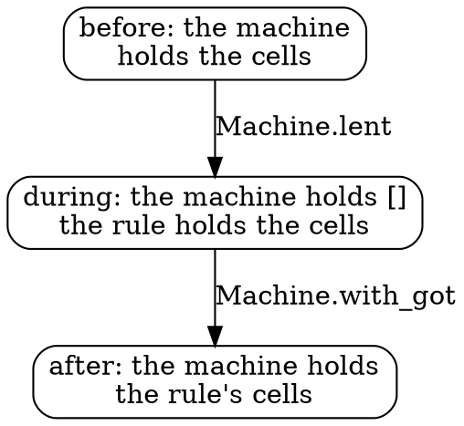

The allocation controls check it ({{chapter Dev and release builds disagree}}). 05-array-push pushes through this path, and the release build is held to exactly one allocation a pass, its list of arguments (`js/controls/expected.txt`); a copy of the heap at each push would be a second.

### The four modules on it

`ValueRules` holds the operators, the property reads and writes, and the patterns. Four modules hold the rest, one kind of value each, and each takes the lent cells and answers a `Got`:

| module | what it holds |
|---|---|
| `StringRules` | the methods of strings (`text_method`), those that count by position on ASCII text alone |
| `ArrayRules` | `push`, `pop`, `splice` and the other array methods that take only values; `map`, `filter`, `sort` and the others that call the program back run the VM's loop, so the VM runs them |
| `CollectionRules` | the walks that a spread, a pattern and `for ... of` make, and the methods of Maps and Sets |
| `BuiltinRules` | the starting globals, what `new` makes, and the builtins that give a value alone |

`console.log`, the canvas, the timers, the program's own functions and the host stay with the VM.

## Handing the machine on

The interpreter's performance work came down to {{chapter Roc's copy rule}} and three habits that follow from it, each about the machine record of {{chapter The interpreter}}. They apply to any Roc program that threads one large record through a loop:

| habit | why | what it bought |
|---|---|---|
| know that a value is copied when it is handed on | each instruction copies the whole inline record once | - |
| box what is rarely written | a boxed part is one pointer in that copy | fib(22) from 123 ms to 82 (`15686d94`) |
| stay under 256 bytes | LLVM copies a record of up to 256 bytes with vector moves, and calls `memcpy` past it | fib(22) from 110 ms to 99 (`3aba5cf7`) |

### A value is copied when it is handed on

Every VM instruction takes the machine and hands it back: `dispatch!` passes it to the instruction's handler, which answers an update of it, `{ ..machine, pc: ... }` or the like. A record update copies the record around the field it writes, so each instruction copies the whole inline record once, however little it changes. That cost is the record's size, paid at every instruction, and the next two habits keep the size down.

One instruction's copy of the machine
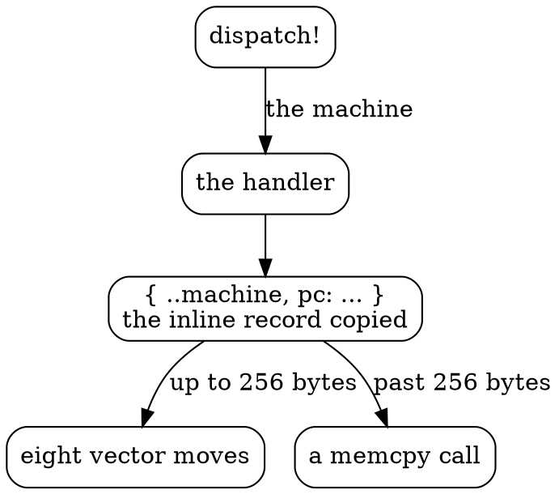

### Box what is rarely written

A part of the machine that most instructions leave alone still adds its bytes to that copy on every instruction while it sits inline. Behind a `Box` it is one pointer. The event queue was the first example: only timers and clicks touch it. Before `15686d94` it sat inline, and a timer's clear wrote it so:

```roc Vm.roc before 15686d94: the queue inline
events : Events.Queue,

Timer(number) => { ..machine, events: Events.without_timer(machine.events, number) }
```

After it, the field is boxed, and each of its few writers unboxes it, writes, and boxes the result:

```roc Vm.roc at 15686d94: the queue boxed
events : Box(Events.Queue),

Timer(number) => { ..machine, events: Box.box(Events.without_timer(Box.unbox(machine.events), number)) }
```

The release build's fib(22) went from 123 ms to 82, and the loops from 441 ms to 350, with every allocation count as it was (`15686d94`'s message). Since every write re-boxes, a box suits a part that is rarely written after it is made.

**Finding a field worth boxing.** List each field of the record beside the handlers that write it. A field that only a few rare instructions write is a candidate: the event queue (the timer builtins and the event loop), the turtle (the turtle's builtins), the collector's schedule (a collection). A field that most instructions write, such as the program counter or the stack's top, stays inline, since boxing it would add an allocation to most instructions. Then weigh the record's size against the line below; `tools/machine_size.shale` holds the machine's size exactly, so a change that moves it fails the gate until the commit says why.

### Stay under 256 bytes

LLVM copies a record of up to 256 bytes with eight vector moves, and calls `memcpy` for a bigger one. The collector's fields, the budget and the boxed turtle took the machine from 232 to 312 bytes, so every instruction paid a `memcpy` call. Boxing the collector's schedule alone left it at 288 bytes, still past the line, which is why that change left the times as they were. Boxing the builtins, the collector's schedule and count, and the step and effect budgets brought it to 248 bytes (`3aba5cf7`):

| release build, best of five, CPU | 312 bytes | 248 bytes |
|---|---|---|
| fib(22) | 110 ms | 99 ms |
| nested loops | 495 ms | 439 ms |
| `memcpy` in fib's profile | 16% | absent |

The lesson in `js/README.md` is that a field added inline counts against the 256, and boxing one part pays off only once the whole machine is back under the line. The line is a cliff: a machine past it pays the whole `memcpy`.

## Why a compiler suits Roc

In one respect the compiler is the simpler of the two programs for Roc. An interpreter has to perform the program's effects while it runs. A compiler reads a text and gives back bytes, one transformation from start to end, and the effects wait for the executable. That difference decides where the copy rule bites, and so where a change to either program is risky.

### The interpreter has effects of its own

The VM runs the program inside the Roc call. When the program calls `console.log`, the VM hands the line to its host's `emit!` then and there; a timer waits on the event queue; a click arrives from the page ({{chapter A canvas in the browser}}). So the VM's loop is effectful, and Roc marks every function on that path with `!` and `=>`: 25 lines of `Vm.roc` declare such a function, and 38 lines across `js/roc/` (lines of the form `name! :`, counted for this chapter on 2026-11-25).

The run's whole state travels with those calls as one value, the machine, and most of the interpreter's performance work went into handing it on cheaply. The cells are lent to a rule and taken back, so a write to the heap stays in place ({{chapter JavaScript's rules for values}}). Every shape that would put a second owner on the heap is a copy cliff, and the machine record is held to 248 bytes so that handing it to each instruction costs vector moves in place of a `memcpy` ({{chapter Handing the machine on}}).

### The compiler is one function

The compiler's whole work is `executable_of`, from the program's text to the executable's bytes, or the reason it refuses:

{{function x86/roc/JsToX86.roc executable_of}}

Its type, `Str -> Try(List(U8), Str)`, has Roc's thin arrow: a pure function. Each stage it calls, through `lowering_of`, is pure too: `Parser.program_of`, `Compile.program`, `Lowering.program_lowering`, `Assembly.assemble` and `Elf.executable`. Across the 25,708 lines of `x86/roc/`, seven definitions carry the `!` of an effect (counted for this chapter on 2026-11-27):

| definitions | where | what they print |
|---|---|---|
| `main!` and `write_program!` | each of the two drivers, `JsToX86.roc` and `Hello.roc` | the bytes |
| `write_inlined!` | `JsToX86.roc` | the count of inlined calls |
| `write_stopped!` | `JsToX86.roc` | a compile stopped at one phase, for timing it |
| `write_labels!` | `JsToX86.roc` | each label's offset, for reading the code back |

Who does the program's effects
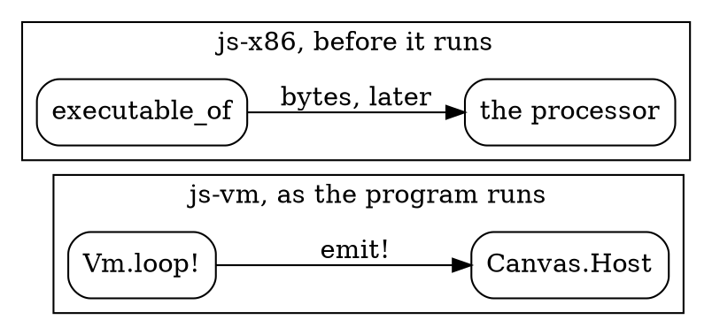

### The processor performs the effects

The program's effects still happen, later, and the processor does them. `console.log` ends in the runtime's `runtime_write`, which fills the output buffer, and the buffer goes out by a `syscall` instruction for `write`. The timers become `runtime_run_timers`, a loop in the executable over a virtual clock. The compiler writes each effect down as instructions, and the processor and the kernel perform them when the executable runs.

Many compilers hand their last step to a C compiler or to LLVM. This one hands it to the metal: the bytes Roc writes are the bytes the processor runs.

### What the copy rule still asks

With the effects gone, the machine record and its lending go too. The lowering's state is the kinds of one function's slots, made afresh for each function on each pass, and the passes are a plain loop over values that ends when the kinds settle. The one large value that grows is the code itself. `Assembly.roc` builds the bytes by appending to one list and patches the placeholders with `set` while that list has one owner, so both passes write it in place (the module's own comment; unchecked by an allocation count). The copy rule of {{chapter Roc's copy rule}} still holds, and in the compiler it governs one list in one place.

A pure function is also plain to test. Each of the encoder's 119 `expect`s holds one instruction's bytes, `rsp` and `r12` as a base and the displacements at the edges of 8 and 32 bits among them, and each was read back through `objdump` during development (`x86/README.md`). An `expect` of a pure function needs a value in and a value out, and the host stays out of it.

The work moved, and some of it moved into the runtime. A routine that the interpreter writes as a Roc function, such as `console.log`'s layout of an array in columns, is in the compiler a list of x86-64 instructions, written one a line in Roc (`x86/roc/Inspect.roc`, 1,185 lines).

## Dev and release builds disagree

Roc has two backends. The dev backend (`--opt=dev`) compiles in about a second and emits code that is mostly stack moves. The release build (`--opt=speed`) goes through LLVM, compiles slowly, and runs the VM's fib(22) about nine times faster: 99 ms of CPU against about 860 (`js/README.md`, 2026-11-24). Three findings about the pair have lasted, and each tells a reader which build answers which question.

### A dev timing says little

Dev timings fail to predict release timings, even in direction:

| change | dev fib(22) | release fib(22) | source |
|---|---|---|---|
| walker: variables read by slot | 674 to 435 ms | 83 to 67 ms | `920cda0c` |
| walker: the Map control's branch against master | 676 to 642 ms | 121 to 169 ms | `3b4f9bd1` |

The second row is a branch that was faster than master on dev and 40% slower in release.

### Some copies happen only in dev

At a helper's boundary the dev build keeps a call that owns its arguments, where the release build specializes the helper first, so the dev build makes copies the release build skips ({{chapter Roc's copy rule}} lists three such shapes). The project met one in its own code. When `ValueRules` was split out, its first version took the engine's whole machine as an open record, and the dev build copied the cells on every write through it: 05-array-push's dev count rose from 3 to 12.73 allocations a pass (`d8d6b7fe`). The rules now take a small machine of the cells, which the VM lends them ({{chapter JavaScript's rules for values}}). A dev-only copy is often a shape that will copy in release once the code around it changes, so the dev counts are held too.

### Count on dev, time on release

`js/controls/` holds nine small programs, each a loop that does one kind of write. `js/controls.shale` runs each at 1,000 and 10,000 passes and holds what one more pass allocates, exactly, in both builds: `expected.txt` for release and `expected-dev.txt` for dev, where each line explains its allocation. Counts are deterministic, so a change that moves one shows on the dev ladder in seconds, and most trials end there. Times are taken on the release build, once a round, from one shared build (`tools/roc_build.shale` keys each build by its inputs), as roc-apps' `CLAUDE.md` (section 9) and `js/README.md` say.

One round of a change
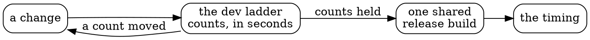

## Build times

A build's time sets the pace of every change, and RC1's release builds were the slowest step in the project's loop. This chapter is about two kinds of build: Roc building the two programs, and js-x86 building a JavaScript program.

### Roc building the interpreter

RC1's release builds were the project's slowest loop, against under a second for a dev build of the same code (the message of roc-apps' tag `rc1-slow-release-build`). The walker's release build grew with the language:

| the walker's release build | time | source |
|---|---|---|
| when the controls first landed | 65 s | `84263a4b` |
| after the language gaps | 686 s | `f0837ff4` |
| `js-run`, about 10,000 lines of Roc | 1,052 s | roc-apps' tag `rc1-slow-release-build` |
| the JavaScript tier, most of it in RC1's SpecConstr pass | 11 to 17 min | roc-apps' [`762c7d3a`](https://github.com/showell/roc-apps/commit/762c7d3a) |

The VM's first round still imported the walker's module for the value rules. After the value rules moved into a module of their own and the VM dropped that import (`d8d6b7fe`), its build fell to an eighth, while `js-run` still took 481 s. The commits leave the cause of the drop unstated.

| the VM's release build | time | source |
|---|---|---|
| the first round, importing the walker | 670 s | `29cb46ec` |
| after the import was dropped | 84 s | `15686d94`, `d7ce2f2c` |
| after the collector | 110 s | `f9188b2f` |
| today | 91 s | `js/README.md`'s status line |

The interpreter works RC1's release pipeline harder than most Roc projects do. Jack Scully profiled the compiler on this code at roc-apps' [`762c7d3a`](https://github.com/showell/roc-apps/commit/762c7d3a) and opened three pull requests against RC1's SpecConstr pass. Each is measured alone, on his machine, against `js-run`'s 271 s release build before them (the pull requests' descriptions):

| pull request | what it changes | `js-run`'s release build |
|---|---|---|
| [#13408](https://github.com/roc-lang/roc/pull/13408) | puts cheap checks ahead of the pass's inlining queries | 166 s |
| [#13409](https://github.com/roc-lang/roc/pull/13409) | restructures the walk those queries run | 63 s |
| [#13410](https://github.com/roc-lang/roc/pull/13410) | stops a recursive function from unrolling into its own body; `fib.js` runs 12% faster and `loops.js` 14% | 83 s |

He put the three together at about 12 times faster for this repository's code specifically (Zulip, #off topic > LLVM). They are expected to merge after Roc 0.10, so every build time above is RC1's own.

### js-x86 building a program, preliminary, as of 2026-11-27

The compiler turns the question around: how long from a program's source to an executable on the disk? `x86/buildrace.shale` times js-x86 against `roc build` of the same race written in Roc, at `--opt=dev` and at `--opt=speed`, the build that makes the fast executable the races run (`x86/buildrace/README.md`). These numbers are preliminary: the box was shared with other lanes, and a run on a quiet box will replace them. The headline, from warm runs at a load of 1.0 to 1.3 (`x86/buildrace/PROFILE.md`, "The build race, before and after"; `x86/RC2.md` for the executables):

| from a race's source to an executable | build time | the executable it makes |
|---|---|---|
| js-x86 | 44 to 94 ms | fast |
| `roc build --opt=dev`, warm | 0.02 to 0.03 s | about 2.3 MB, 10 to 25 times slower than `--opt=speed`'s |
| `roc build --opt=speed`, warm | 0.72 to 3.8 s | 32 to 180 KB, fast |

So js-x86 builds 15 to 50 times faster than the Roc build that makes a fast executable; Roc's dev build is faster still, and makes a slow one.

## How it is tested

A check is trusted once it has been seen to fail. Each check below holds the code to a fixed answer, and each count is exact.

### The oracle against node

`js/oracle.shale`, a tier of the default `check.shale`, holds `js-vm`'s transcript and exit code on every corpus program to node's, 63 of them, and every refusal to its message. Every program runs, and the run fails if any one fails. It also runs with `collect=every`, which collects after every instruction that allocates, and programs 51 to 53 hold values through each kind of root while collections run.

### The compiler's checks

`x86/programs.shale`, also a tier of `check.shale`, compiles each program in `x86/tests/` and holds what its executable prints, and its exit code, to node's; each program in `x86/tests/refused/` names the refusal `js-x86` must print or the line its executable must stop with. Then it holds the corpus to `x86/corpus.txt`, the list of programs whose executables match node, so a program that starts or stops matching fails the gate until the list moves. It holds the count of calls the inliner puts in line across `x86/tests/` exactly (its `INLINED`), and runs every executable with `heapwalk`, which checks every block's header at the exit (`x86/COLLECTOR.md`). `x86/hello.shale` runs the backend's 134 expects, the encoder's 119 among them, each holding one instruction's bytes, and `x86/fib.shale` the compiler's 230 (each script's `EXPECTS`, held exactly, as of 2026-11-27).

### Controls held exactly

`check.shale js=1` runs the nine allocation controls of {{chapter Dev and release builds disagree}}, in both builds. A missing expected file fails the run (`80b5e681`).

### Golden logs for the canvas

`js/canvas.shale` holds each of the 9 canvas samples to its log of effects for scripted frames, keys and clicks, and a log moves only by an explicit freeze.

### The page check

`js/page_check.mjs` drives the page's own JavaScript under node. It holds the wasm to node on every corpus program and refusal, holds the samples to their golden logs, and checks the memory view. The page is replaced only after it passes.

### Planted faults

A planted fault is a deliberate bug, committed to show that a check catches it, then reverted. The interpreter's record lists five:

| the fault planted | what turned red | commit |
|---|---|---|
| a line width of 72 instead of 80 | one program | `278631d8` |
| the event queue left out of the roots | program 52 | `b623437d` |
| `filter`'s item left off the stack | program 53 | `b623437d` |
| a wrong expected count | 00-loop, by name | `80b5e681` |
| a memory view with its collection marks taken out | page_check | `668c52ca` |

`tools/machine_size.shale`'s header records one more: the machine's size held at 247 went red naming 248. The compiler's commits list their own, each reverted too:

| the fault planted | commit |
|---|---|
| a wrong expected byte of `lea`'s encoding, and a wrong hello-world text | `c3ff721` |
| `<` lowered with the wrong condition | `0c5ea7e` |
| each rule of the inliner's budget | `22361e1` |
| three faults in the heap's headers and pages | `a328636` |

## Limitations

The subset covers a part of JavaScript on purpose, and it will never cover every corner of the language. A program that steps outside it is refused with a message naming what it used; it never gets a wrong answer.

This chapter is the list a reader starts from before extending either program. The limits fall in four groups: the runtime, small on purpose; the language, fairly complete; the compiler, which runs less of it; and a few that come from the tools.

### Runtime

- **In the browser, a program gets only the playground's small API:** one 400 by 400 canvas, the mouse and keys, the timers, `frame(t)`, `onCollect` and `console.log` ({{chapter A canvas in the browser}}). Every statement of the program runs in the Roc VM, compiled to wasm. The page's own JavaScript paints the lines the VM emits and passes clicks and keys in; the program's code runs only in the VM.
- **At the command line, `js-vm`'s runtime is as small:** `console.log`, the timers, and the builtins `js/README.md` lists under "The subset" (`Math`, the methods of strings, arrays, Maps and Sets, `Object.keys` and its kin). Files, processes, `require`, the network and node's other modules are out of reach. The compiler to x86-64 in `x86/` keeps the same small runtime, and adds `Date.now()`, which the VM refuses (`x86/README.md`).
- **Async is out:** promises, `async` and `await` are refused. Timers are the one way to wait, on a virtual clock that runs each callback after the program, in node's order.
- An interval never cleared stops after 100,000 callbacks with a message, where node runs it for good (`js/README.md`, "The subset").
- On the page, a program is held to step budgets, 3,000,000 before the first frame and 300,000 a frame ({{chapter A canvas in the browser}}).

### Language

The language itself is fairly complete: numbers, strings, arrays, objects, closures, `let` and `const`, `try` and `finally`, `switch`, destructuring, optional chains, spread, Maps, Sets and classes ({{chapter Introduction}}). These are its known differences from node:

- Printing or listing a class instance, or printing a class, is refused: node prints an instance by its class's name first (`js/README.md`, "Classes are syntax sugar").
- An instance's property named `"þsuper m"` reads its class's parent's method `m`, which is the key `super.m` is written as, where node's is `undefined` (the same section). The key starts with þ, outside ASCII, so only a program that spells that letter can reach it.
- An exhausted Map iterator still sees entries added after it finished, where node's stays done. No corpus program holds this yet.
- A builtin's callback (`map`, `sort`, a Map's `forEach`) throws a RangeError once 400 calls wait under it, where a plain call goes 10,000 deep, near node's own limit (`f4320451`).
- A string method that counts positions is refused on non-ASCII text: JavaScript counts UTF-16 units, and these strings are UTF-8 (`js/README.md`, "The subset").

The parser refuses these forms, each with a message that names it: getters and setters, `#private` names, class fields, static blocks, computed method names, class expressions, `this` outside a class's code or in a static method, `super` misused, a constructor that returns a value, `extends` of anything but a class declared above, a class's name declared again or assigned, `new` on a program's own function, `var`, `in`, `eval`, regular expressions, async and modules. A run refuses `==` and the other coercions, and the rest of `js/README.md`'s list, "The subset", where only the run can see them.

### The compiler

The compiler runs the same subset less completely, and says where. A program it has yet to compile is refused by name before a byte is written; what only a value can decide stops the executable with a line `x86: ... is not compiled yet` and exit 1 (`x86/README.md`). As of 2026-11-27:

- It matches node on 51 of the 63 corpus programs; {{chapter The compiler to x86-64}} gives the first reason each of the other 12 meets.
- `console.log` writes a number only when it is an integer of at most 2^53, `NaN`, an infinity or -0. Fractions wait on milestone 4's shortest round-trip printing; four corpus programs stop there, three on a fraction and one on an integer past 2^53.
- `Math.sin`, `cos`, `tan` and `atan` are refused, since node's last digits are those of V8's port of fdlibm; so are `Number`, `JSON`, `new Date()` and the array methods `at`, `fill` and `flat`.
- A string must be ASCII: a length here counts bytes, where JavaScript counts UTF-16 units.
- An uncaught error stops the executable with exit 1, where node also prints its report of the source line; `console.log` of an error, or of an array or object of more than 100 items, stops it too.
- `%` of fractions, and `**` with a fraction, a negative exponent or a power past 2^53, stop the executable.
- A recursion goes deeper than node's: node throws between 9,000 and 10,000 calls of a one-line recursion, the executable between 80,000 and 90,000, so a program between the two runs here and throws in node.
- The heap is 2 GiB; past it the program stops with a line saying the heap is full.

### The tools

- `js-vm` takes the program as one command-line argument, limited to 128 KiB (`js/README.md`, "Pitfalls").
- `onCollect` and the other canvas builtins are this project's own, so logs of effects judge them in place of node.

## Appendix A: The playground's samples

Each of these runs in [the playground](https://roc.lynrummy.com/js/), where it can be changed and run again. Each console sample is followed by what js-vm prints for it, made when the book is built.

{{listing samples}}

## Appendix B: The tested programs

### The corpus

Each program prints what node prints, and `js/oracle.shale` holds the VM to it. Each name links to the program; the three the playground features are in full in Appendix A.

{{listing corpus}}

### The refused programs

The VM refuses each program with the message under its name, which the program's first line gives.

{{listing refused}}